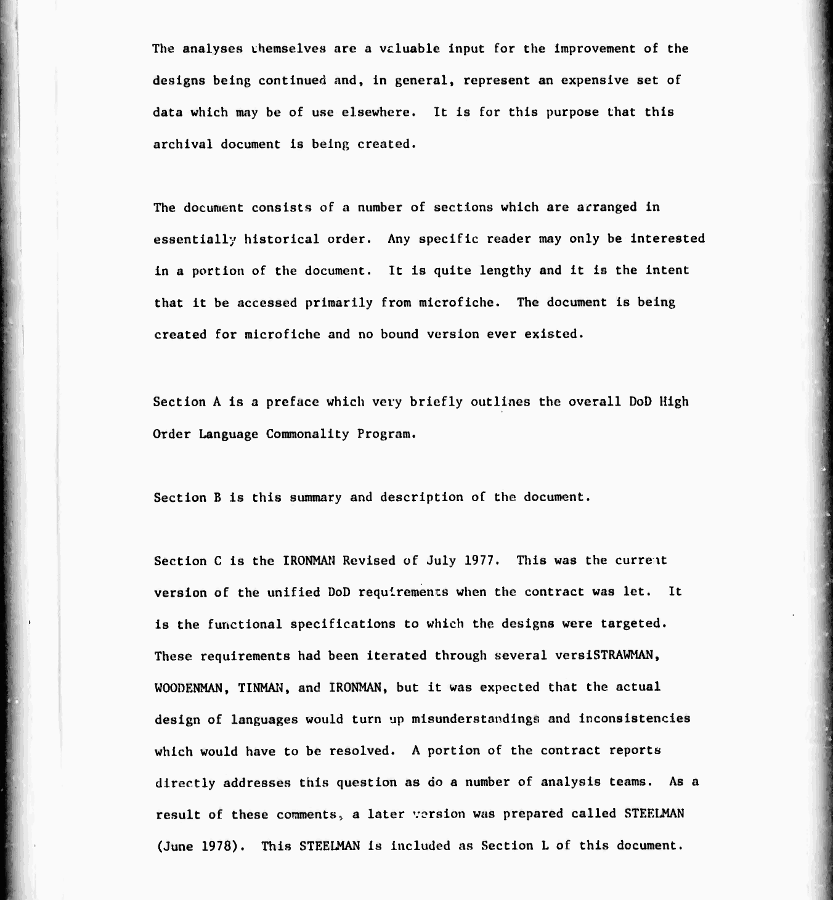
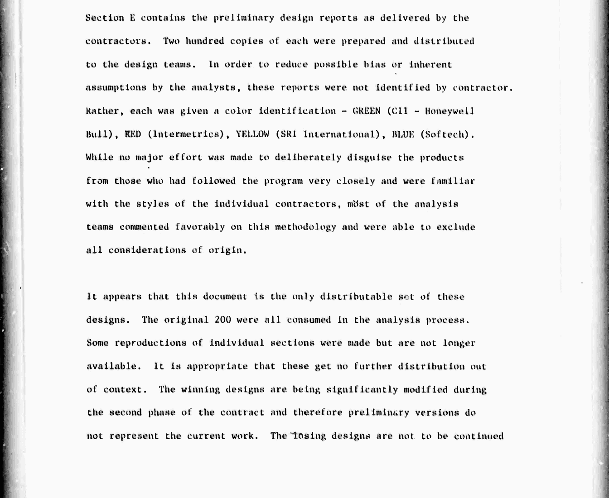

# Книга, которую делали для микрофиш

Сначала о том, откуда вообще взялись тексты. В 2023 году в рассылке systemsafety, где обсуждают надёжность критичного софта, мелькнуло сообщение: по просьбе одного энтузиаста DTIC, архив технической документации Минобороны, отсканировал том «DoD Common High Order Language, Phase 1» под номером ADB950587, 4575 страниц, и в нём лежат все четыре проекта первого тура. Пока я занимался красным и зелёным, сайт DTIC сначала закрылся на обслуживание, а потом стал отвечать отказом на любые запросы, даже из обычного браузера. Выручила Wayback Machine: в сентябре 2023 года кто-то сохранил туда этот PDF целиком. На нём стоит та же пометка, что и на руководстве по RED: «допущено к открытой публикации, распространение не ограничено».

Предисловие книги само по себе маленький исторический документ. Составители пишут, что книгу делали для микрофиш — карточек фотоплёнки с уменьшенными страницами, которые читали через увеличитель, — и переплетённой версии у неё никогда не было, а все двести экземпляров проектов ушли рецензентам, так что этот том — единственный комплект, который вообще можно распространять. Там же раскрыты цвета. А заканчивается предисловие фразой, которую я перечитал несколько раз: проигравшие проекты продолжать не будут, интересны они разве что исследователям, цель программы — сходимость, и поощрять альтернативы сейчас неуместно.

Внутри четыре предварительных проекта в том виде, в каком их сдали 15 февраля 1978 года. Красный там в первой редакции, тот самый REDL с мониторами, который красная команда потом выбросила и начала заново. За проектами идут разборы от восьмидесяти команд, от университетов до военных подрядчиков, и отчёт так называемой питтсбургской панели. Эта панель изучала разборы, расспрашивала авторов и свела всё в таблицы, по которым в апреле 1978 года решали, кто пойдёт дальше.

Распознанный текст местами ужасен: ноль вместо буквы O, доллар вместо S, буква l вместо знака процента. Поэтому каждую программу сверяли с изображением страницы, а синие, где в коде полно обратных косых черт и решёток, и вовсе переписывали с картинок.

## Кто их делал

Синий проект вёл Джон Гуденаф из SofTech. Имя это в истории Ады не последнее. В 1975 году он опубликовал в Communications of the ACM одну из первых больших работ об обработке исключений, а после конкурса именно SofTech под его руководством получила контракт на набор тестов, по которому проверяли каждый компилятор Ады на соответствие стандарту. Гуденаф потом возглавлял группу, которая толковала стандарт, и писал требования к Аде 95. Так что синяя команда проиграла язык, но осталась при Аде на двадцать лет, только по другую сторону стола.

Жёлтый проект вёл Джей Спитцен из SRI International, исследовательского института в Калифорнии, где тогда строили SIFT, отказоустойчивый бортовой компьютер для самолётов. К нему мы ещё вернёмся. Популярная книга Time-Life 1986 года и Бертран Мейер пишут, что жёлтую команду консультировали Хоар и Вирт. В самом документе консультанты не названы по именам, но следы видны на каждой странице: структура описания повторяет «Сообщение о Паскале» Вирта, модули взяты из его Модулы, мониторы из статьи Хоара 1974 года, а в списке литературы есть ссылки «Хоар, частное сообщение» и «Вирт, частное сообщение».

## Что о них думал Дейкстра

Дейкстра потратил март 1978 года на то, чтобы прочитать все четыре проекта, и на каждый написал по рецензии. Синему досталось за главу о типах и операциях, которая, по его словам, «разрослась до 160 (!) страниц». Жёлтый он назвал безнадёжной мешаниной и добавил, что сочувствует консультантам, которым не удалось этого предотвратить. Если вспомнить, кого называют консультантами жёлтой команды, фраза звучит особенно колко.

Про красный и зелёный он тоже писал без восторга, так что по Дейкстре проигравших от победителей не отличить. Разницу решили рецензенты и панель, и к их выводам я вернусь, когда покажу оба языка в работе.
