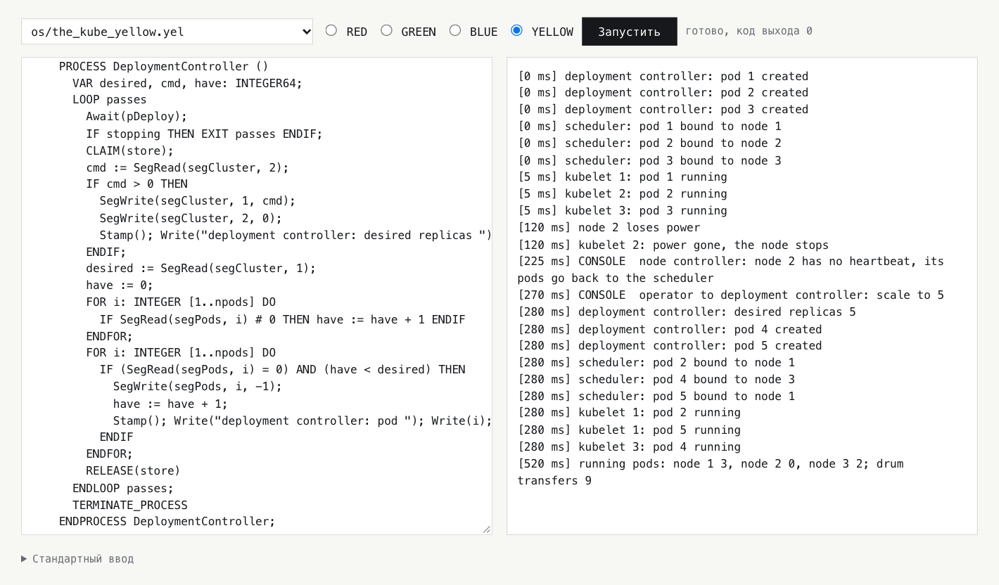
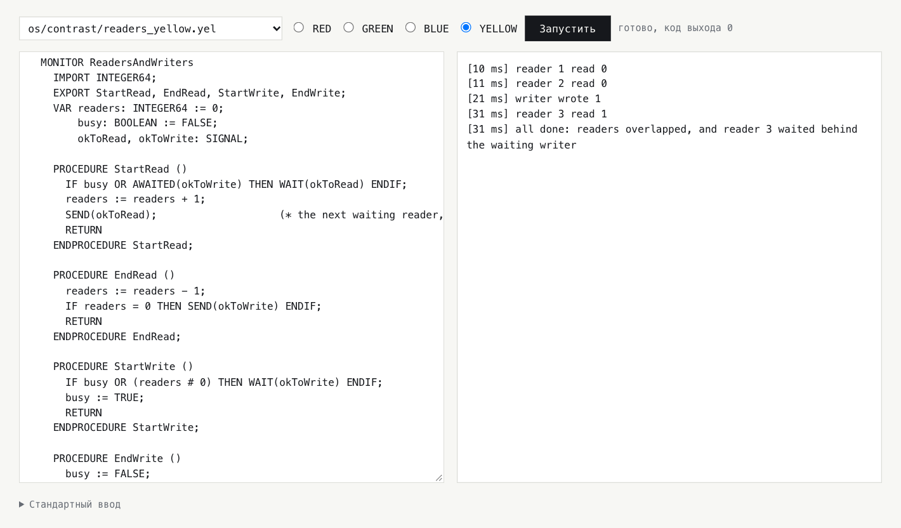

# Ещё две Ады: я восстановил синий и жёлтый языки, которые Пентагон отверг в 1978 году, и написал на них операционную систему Дейкстры и Kubernetes

В феврале 1978 года четыре команды сдали Министерству обороны США предварительные проекты языка, которому через год дадут имя Ада. Проекты обезличили цветами. Зелёный делала франко-американская команда Жана Ишбиа, красный бостонская Intermetrics, синий SofTech, жёлтый SRI International. Весной 1978 года во второй тур прошли зелёный и красный, а синий и жёлтый отправились в архив. Через год зелёный победил и стал Адой.

В [статье о финалистах](ССЫЛКА) я восстановил красный и зелёный языки: собрал их по документам 1979 года, написал на каждом компилятор, который компилирует сам себя, и вырастил на них операционную систему и Kubernetes. Синий и жёлтый тогда казались недоступными. Их документы лежали в томе на четыре с половиной тысячи страниц, который архив Минобороны перестал выдавать. Потом нашлась копия в веб-архиве, и я сделал с этими двумя языками то же самое.

Это рассказ о двух проектах, которые проиграли первыми. Синий — язык, в котором всё держится на типах, даже присваивание. Жёлтый — Паскаль, переделанный под требования военных. Задачи в нём общаются не через рандеву, как в зелёном языке и в Аде, где одна задача ждёт другую у «двери» и они встречаются, а через мониторы Хоара — модули с общими данными, в которые одновременно может войти только один процесс. Для обоих языков я написал компиляторы на них самих, оба запустили программы, которые их авторы написали в 1978 году и никогда не видели работающими, и на обоих работают система THE Дейкстры и Kubernetes поверх неё.

<cut />

Но главное здесь не сами языки, а то, что теперь все четыре проекта можно поставить рядом и сравнить не по рецензиям, а по работающему коду. Одна и та же задача на четырёх языках ведёт себя по-разному, и эти различия оказались куда интереснее, чем я ожидал. В синем языке 1978 года параллельный блок передаёт ошибку упавшей ветки тому, кто его открыл, — к этому индустрия пришла только в последние годы. А замок в нём сам отпускается, если его владелец погиб. В жёлтом прямо в язык встроено симулированное время, где часы идут только тогда, когда этого хочет программа.

Статья длинная, поэтому коротко о том, что где. Сначала о книге 1978 года, из которой взялись тексты, и о людях, которые эти языки делали. Потом экскурсия по синему и жёлтому языкам. Дальше одна и та же задача на всех четырёх языках и сводная таблица различий, компиляторы и программы 1978 года, THE и Kubernetes, и почему эти проекты проиграли. В конце — что из них потом досталось Аде, и какой могла бы стать индустрия, если бы конкурс выиграл синий или жёлтый.

Это очередная часть моей серии о палеокомпьютинге. Мне интересно, какие идеи жили в технологиях, которые проиграли, что мы утратили вместе с ними и что из утраченного вернулось потом в других технологиях. Статью о финалистах читать не обязательно: где нужно, я коротко напомню, как устроены красный и зелёный языки.

Все исходники, заметки и инструкции лежат в репозитории [github.com/tym83/paleocomputing](https://github.com/tym83/paleocomputing), в каталоге `impl/ada-colors`, и доступны под лицензией Apache 2.0.
# Книга, которую делали для микрофиш

Сначала о том, откуда вообще взялись тексты. В 2023 году в рассылке systemsafety, где обсуждают надёжность критичного софта, мелькнуло сообщение: по просьбе одного энтузиаста DTIC, архив технической документации Минобороны, отсканировал том «DoD Common High Order Language, Phase 1» под номером ADB950587, 4575 страниц, и в нём лежат все четыре проекта первого тура. Пока я занимался красным и зелёным, сайт DTIC сначала закрылся на обслуживание, а потом стал отвечать отказом на любые запросы, даже из обычного браузера. Выручила Wayback Machine: в сентябре 2023 года кто-то сохранил туда этот PDF целиком. На нём стоит та же пометка, что и на руководстве по RED: «допущено к открытой публикации, распространение не ограничено».


Предисловие книги само по себе маленький исторический документ. Составители пишут, что книгу делали для микрофиш — карточек фотоплёнки с уменьшенными страницами, которые читали через увеличитель, — и переплетённой версии у неё никогда не было, а все двести экземпляров проектов ушли рецензентам, так что этот том — единственный комплект, который вообще можно распространять. Там же раскрыты цвета. А заканчивается предисловие фразой, которую я перечитал несколько раз: проигравшие проекты продолжать не будут, интересны они разве что исследователям, цель программы — сходимость, и поощрять альтернативы сейчас неуместно.

Внутри четыре предварительных проекта в том виде, в каком их сдали 15 февраля 1978 года. Красный там в первой редакции, тот самый REDL с мониторами, который красная команда потом выбросила и начала заново. За проектами идут разборы от восьмидесяти команд, от университетов до военных подрядчиков, и отчёт так называемой питтсбургской панели. Эта панель изучала разборы, расспрашивала авторов и свела всё в таблицы, по которым в апреле 1978 года решали, кто пойдёт дальше.

Распознанный текст местами ужасен: ноль вместо буквы O, доллар вместо S, буква l вместо знака процента. Поэтому каждую программу сверяли с изображением страницы, а синие, где в коде полно обратных косых черт и решёток, и вовсе переписывали с картинок.

## Кто их делал

Синий проект вёл Джон Гуденаф из SofTech. Имя это в истории Ады не последнее. В 1975 году он опубликовал в Communications of the ACM одну из первых больших работ об обработке исключений, а после конкурса именно SofTech под его руководством получила контракт на набор тестов, по которому проверяли каждый компилятор Ады на соответствие стандарту. Гуденаф потом возглавлял группу, которая толковала стандарт, и писал требования к Аде 95. Так что синяя команда проиграла язык, но осталась при Аде на двадцать лет, только по другую сторону стола.

Жёлтый проект вёл Джей Спитцен из SRI International, исследовательского института в Калифорнии, где тогда строили SIFT, отказоустойчивый бортовой компьютер для самолётов. К нему мы ещё вернёмся. Популярная книга Time-Life 1986 года и Бертран Мейер пишут, что жёлтую команду консультировали Хоар и Вирт. В самом документе консультанты не названы по именам, но следы видны на каждой странице: структура описания повторяет «Сообщение о Паскале» Вирта, модули взяты из его Модулы, мониторы из статьи Хоара 1974 года, а в списке литературы есть ссылки «Хоар, частное сообщение» и «Вирт, частное сообщение».

## Что о них думал Дейкстра

Дейкстра потратил март 1978 года на то, чтобы прочитать все четыре проекта, и на каждый написал по рецензии. Синему досталось за главу о типах и операциях, которая, по его словам, «разрослась до 160 (!) страниц». Жёлтый он назвал безнадёжной мешаниной и добавил, что сочувствует консультантам, которым не удалось этого предотвратить. Если вспомнить, кого называют консультантами жёлтой команды, фраза звучит особенно колко.

Про красный и зелёный он тоже писал без восторга, так что по Дейкстре проигравших от победителей не отличить. Разницу решили рецензенты и панель, и к их выводам я вернусь, когда покажу оба языка в работе.
# BLUE: язык, в котором всё держится на типах

Синий язык из четырёх самый непривычный на вид, поэтому начну с короткой программы из лабораторной. Она меняет местами два целых, две строки и два цвета одной и той же процедурой:

```
TYPE COLOR = ENUM (\RED, \GREEN, \BLUE);
VAR I, J: INTEGER;
VAR A, B: ASCII_STR (4);
VAR K, M: COLOR;
...
SWAP (# I, J);
SWAP (# A, B);
SWAP (# K, M);

PROCEDURE SWAP (# X, Y: ?T) WHERE T NEEDS (STORE_ (T ## T));
   VAR TMP: T;
   TMP := X;
   X := Y;
   Y := TMP;
END PROCEDURE SWAP;

FUNCTION FRAME (S: ASCII_STR (?L)) RETURNS (ASCII_STR (L + 2));
   RETURN '[' !! S !! ']';
END FUNCTION FRAME;
```

Здесь почти каждый значок что-то значит, так что разберу по порядку.


Литералы перечислений пишутся с обратной косой чертой: `\RED`, `\GREEN`. Это не прихоть. Литерал в синем языке не принадлежит одному типу, и `\GREEN` может быть сразу цветом светофора и цветом радуги, на разных позициях в каждом. Какой из них имеется в виду, решает контекст, а если контекста не хватает, тип указывают явно: `[COLOR]$$(\GREEN)`. Есть и неупорядоченные перечисления, `UNORDERED`, у которых определено только равенство: масть карты больше или меньше другой масти не бывает, и язык не даёт притвориться, что бывает.

Параметры процедуры делятся на три группы — входные, изменяемые и выходные, — а решётки ставятся между группами. В `SWAP (# X, Y)` входных нет, и оба параметра изменяемые. В `STORE_ (T ## T)` один входной `T`, изменяемых нет, и один выходной `T`: присваивание берёт значение и выдаёт новое значение переменной. Группы видны и в месте вызова: `SWAP (# I, J)` сразу говорит читателю, что `I` и `J` поменяются.

`?T` — это обобщённый тип, который выводится из аргумента. Экземпляр процедуры для каждого типа создаётся сам, в точке вызова, никто его не называет и не объявляет. В красном языке было так же, а в зелёном и в Аде экземпляр надо создать явно. Выводить можно не только типы: `ASCII_STR (?L)` берёт из аргумента длину строки, и функция `FRAME` обещает вернуть строку длиной `L + 2`. Длина живёт в типе, и компилятор её знает.

А `WHERE T NEEDS (STORE_ (T ## T))` — список того, что телу процедуры нужно от типа `T`. Здесь нужно только присваивание. Эти операции берутся там, откуда процедуру вызвали, и если у типа присваивания нет, вызов не скомпилируется с понятной ошибкой в месте вызова, а не где-то в глубине экземпляра. Сегодня такое называют концептами в C++ или ограничениями трейтов в Rust.

## Присваивание — тоже функция

`STORE_` в предыдущем примере не опечатка. В синем языке каждая операция, включая присваивание, сравнение и взятие подстроки, — это вызов функции с фиксированным именем: `ADD_`, `EQUAL_`, `LESS_THAN_`, `SUBSTRING_`, `STORE_`. Абстрактный тип, экспортированный из модуля, определяет себе сложение и присваивание одним и тем же способом, как обычные подпрограммы. В Аде своего присваивания нет до сих пор: контролируемые типы Ады 95 позволяют задать действия после копирования и перед уничтожением, но не само присваивание. А вот в C with Classes, предшественнике C++, переопределять присваивание можно было уже в 1980 году.

Один из рецензентов 1978 года написал, что синий ближе всех подошёл к тому, чтобы сделать понятие типа объединяющей силой языка. Лучшего короткого описания я не знаю. Числа с фиксированной точкой задаются масштабом, основанием и точностью: `FIXED (scale, radix, precision)`, и `INTEGER` — просто фиксированная точка с нулевым масштабом. Для бортовых машин семидесятых, где плавающей точки часто не было вовсе, это была рабочая лошадка, и синий описывает её подробнее всех. Строки бывают в разных кодировках, и функция над строками обобщается по кодировке. А на уровне машины тип может назначить своим значениям коды, которые выбрало железо:

```
TYPE STATUS = UNORDERED (\IDLE, \BUSY, \DONE, \FAULT)
   REP ENUM_VAL_REP (4, VALUES (\IDLE AS BIN '0000', \BUSY AS BIN '0001',
                                \DONE AS BIN '1000', \FAULT AS BIN '1111'));
...
SELECT OBJECT_MACHINE FROM
   PDP_11 -->
      S := [STATUS]$$(REGISTER);
   END;
END SELECT;
```

Здесь две детали. Свои коды разрешено задать только неупорядоченному типу: коды железа могут идти в любом порядке, и тогда они не смогут нести порядок значений. Ада пришла к тому же с другой стороны: в ней коды можно задать любому перечислению, но обязательно по возрастанию. А прочитать код из регистра устройства как значение типа можно только в машинно-зависимой части, внутри `SELECT OBJECT_MACHINE`, где программа прямо говорит, на каком железе она это делает.

## Закрытые области и объявленные исключения

Как и в красном языке, процедура в синем — закрытая область: внешних переменных она не видит, пока не импортирует их. Синий здесь строже красного. Процедура, которая вызывает другую процедуру, должна импортировать либо её, либо все переменные, которые та трогает. Так что по заголовку любой процедуры видно, до какого состояния она может дотянуться через всю цепочку вызовов. Решётка в списке импорта работает так же, как в параметрах: в `IMPORTS (DATA: (# MUTEX, BALANCE))` всё стоит после решётки, то есть переменные импортированы для изменения, а то, что процедура только читает, пишется до неё.

Исключения в синем языке объявляются в заголовке подпрограммы: `SIGNALS (OVERFLOW, INVALID_FORMAT)`. Подпрограмма не может выпустить наружу исключение, которого нет в этом списке. Обоснование SofTech объясняет это ровно тем же, чем списки импорта: интерфейс процедуры должен быть описан полностью, и что она может бросить, — такая же его часть, как то, что она может изменить. В 1978 году так делали разве что в CLU у Барбары Лисков, а в мейнстрим проверяемые исключения, то есть такие, которые компилятор заставляет объявить или обработать, пришли с Java. В Аде их нет и не было.

Обработчик исключения в синем языке привязан к оператору, а не к блоку: `EXCEPT` ставится после любого оператора. Это кажется мелочью, пока не напишешь `BLOCK ... EXCEPT ... END BLOCK` и не обнаружишь, что обработчик относится к последнему оператору блока, а не ко всему блоку. Я на этом попался, и в заметках к компилятору это теперь отдельный пункт.

## Параллельный блок, который не теряет ошибок

С параллельностью синий язык строже всех четырёх. Задач в привычном смысле нет. Есть параллельный блок `PAR_BLOCK`, внутри него пути `PATH`, и блок не заканчивается, пока не закончатся все его пути. Сам по себе такой блок не нов, это `parbegin ... parend` Дейкстры 1965 года. Новое в другом: если какой-то путь погиб с исключением, которое ему разрешено выпускать, блок дождётся остальных и поднимет это исключение у себя:

```
VAR MUTEX: SEMAPHORE (REGION) := NEW (1);
VAR BALANCE: INTEGER := 100;
PAR_BLOCK
   PATH WORKER FOR ID IN [1:2] SIGNALS (FAILED) IMPORTS (DATA: (# MUTEX, BALANCE));
      PAUSE (ID);          % PAUSE и LOG — мои процедуры: ожидание в миллисекундах
      REQUEST (# MUTEX);   % и строка журнала с отметкой времени
      PAUSE (5);
      IF ID = 1 THEN
         SIGNAL FAILED;
      END IF;
      BALANCE := BALANCE + 10;
      RELEASE (# MUTEX);
   END PATH WORKER;
END PAR_BLOCK;
EXCEPT
   FAILED --> LOG ('the block signals FAILED: worker 1 ended abnormally'); END;
END EXCEPT;
```

Сегодня это называют структурной параллельностью: параллельные ветки живут внутри лексического блока, блок не завершается раньше них, и ошибка ветки не теряется, а приходит к тому, кто блок открыл. Последние лет восемь её заново вводят повсюду: питонская библиотека Trio, группы задач в Swift, `StructuredTaskScope` в Java. Синий проще их. Сбой одной ветки не отменяет соседние, это пишут руками через `TERMINATE`, и если упали две ветки, наружу придёт только одно исключение. Но главное в нём уже есть.

В Аде 83 блок тоже ждёт свои задачи, но задача, погибшая с необработанным исключением, просто тихо завершается, и тот, кто её запустил, ничего не узнаёт. Это одна из самых известных ловушек Ады. В синем языке 1978 года этой ловушки нет.

Цена у строгости тоже есть. Параллельный блок нельзя поставить внутрь подпрограммы, так что запустить пару путей из процедуры не получится, и это ещё аукнется в Kubernetes.

## Два вида семафоров

Почтовых ящиков и рандеву в синем языке нет, путь с путём договариваются через семафоры. Семафор Дейкстры — это счётчик с двумя операциями: P ждёт, пока счётчик больше нуля, и уменьшает его, V увеличивает счётчик и будит одного ждущего. В синем языке семафоры бывают двух видов, и разница между ними продумана очень тонко. Семафор `SYNCH` — классический семафор без владельца: один путь ждёт события, другой о нём сообщает. Семафор `REGION` — замок с владельцем вокруг общих данных, то, что сегодня назвали бы мьютексом. Если путь, который держит такой замок, завершился аварийно, замок отпускается сам.


В примере выше первый рабочий погибает с семафором в руках, а второй тут же входит, и баланс получается 110, а не вечное ожидание второго. Важно слово «аварийно». Путь, который сам поймал исключение и пошёл дальше, свои замки держит, и это стало одной из лабораторных.

Почему не отпускать при гибели все семафоры? Обоснование SofTech отвечает так. Отметить «этот путь держит замок» можно только внутри самой операции захвата, потому что любой флаг, выставленный следом, может не успеть выставиться до гибели пути. Значит, отпускать замок умершего должна система, а не его обработчик. Но если отпускать все семафоры, то сигнальные тоже, и умирающий путь разошлёт ложные сигналы тем, кто ждёт совсем другого события. Поэтому видов два, и отпускаются только замки.

SofTech сама приводит возражение, которое ей высказывали: данные под отпущенным замком могут остаться наполовину обновлёнными. Обоснование с этим соглашается и отвечает, что во встроенной системе их скоро перезапишут свежие показания датчика. Через тридцать лет та же проблема появится в стандарте POSIX, и решат её строже: устойчивый мьютекс, хозяин которого умер, достаётся следующему с кодом `EOWNERDEAD`, и новый хозяин обязан объявить данные согласованными, иначе мьютекс станет непригодным. У синего такого сигнала нет, замок передаётся молча.

Со временем в синем языке тоже не всё привычно. `WAIT (30)` усыпляет путь на тридцать секунд, и секунды эти — число с фиксированной точкой по основанию два, так что миллисекунду в них ровно не запишешь. А `CLOCK`, в моём прочтении спецификации, показывает время работы конкретного пути, а не время суток.
# YELLOW: Паскаль, которому велели выполнить Ironman

Если синий язык начинал с типов, то жёлтый начинал с Паскаля. Требования к языку Минобороны писали поэтапно, и редакции назывались Strawman, Woodenman, Tinman, Ironman и Steelman — от соломенного человека до стального, каждая подробнее предыдущей. Проекты первого тура сдавали по Ironman 1977 года. SRI прямо пишет в отчёте, что её задачей было спроектировать язык, переделав Паскаль под требования Ironman. Описание жёлтого языка повторяет нумерацию разделов «Сообщения о Паскале» Вирта, вплоть до пустого раздела, оставленного только ради совпадения номеров. Программа на нём читается как Паскаль с длинными закрывающими словами:

```
MODULE Enumerations
  IMPORT TextIO, StandardImplementationPrelude;
  REPRESENTATION
    Phase = ORDERED (Pending, Running, Succeeded);
    Fruit = UNORDERED (Lemon, Lime, Orange);
  VAR p: Phase := Pending;

  PROCEDURE WritePhase (CONST p: Phase)
    SELECT p
      CASE Pending => Write("Pending")
      CASE Running => Write("Running")
      CASE Succeeded => Write("Succeeded")
    ENDSELECT;
    RETURN
  ENDPROCEDURE WritePhase;

  FOR q: Phase DO WritePhase(q); Write(" ") ENDFOR;
  ...
ENDMODULE Enumerations
```

К Паскалю добавлены модули из Модулы, мониторы и сигналы, шаблоны модулей, исключения и перегрузка. Регистр букв различается: зарезервированные слова пишутся заглавными, а имена как угодно. Знака «не равно» в ASCII не нашлось, и он пишется решёткой, как в Модуле.

## Тип и представление

Главная собственная идея SRI — разделение типа и представления. Слово «представление» здесь значит не машинный формат, как `REP` в синем языке, а ограничение значений. `INTEGER` — это тип, множество значений с операциями. `INTEGER [1..10]` — его представление, с диапазоном, а для чисел с плавающей точкой ещё и с точностью, для фиксированной — с шагом. Объявить переменную можно только через представление, голый `INTEGER` для этого не годится. Зато два представления одного типа совместимы: `INTEGER [1..5]` и `INTEGER [0..9]` — один тип, и присваивание между ними просто проверяет диапазон. Перечисления тоже объявляются как представления, в секции `REPRESENTATION`, как в примере выше.

Это ровно то, что в Аде называется подтипами: `subtype SMALL is INTEGER range 1 .. 10` не создаёт нового типа, а только ограничивает старый. Только в Аде подтип — дополнительная возможность, а в жёлтом языке без представления не обойтись. Новый тип создаёт отдельное объявление, `TYPE T = INTEGER`, и его литералы пишут с именем типа: `T 50`.

Перечисления бывают упорядоченными и неупорядоченными, как в синем языке, и `BOOLEAN` здесь неупорядоченный: истина не больше лжи. Перегрузка только явная. Новое определение функции с тем же именем помечают словом `EXTENDS`, если оно добавляется к старым, или `REPLACES`, если заменяет. Без пометки новое объявление прячет все старые. Так что случайно перегрузить что-нибудь в жёлтом языке невозможно, и при чтении сразу видно, где имя получило новый смысл.

## Два правила, о которые спотыкаешься в первый же день

Вычитание в жёлтом языке не ассоциативно. Сложение и умножение ассоциативны, и `a + b + c` пишется без скобок, а вот `a - b - c` — синтаксическая ошибка, как и `a * b DIV c`. Порядок приходится указать скобками: `(a - b) - c`. Паскаль и почти все остальные языки читают это выражение слева направо. Это не прихоть SRI: так требовал Ironman, пункт 4G, — скобки обязательны, если слева от операции того же приоритета стоит неассоциативная. SRI выполнила требование буквально, а SofTech в обосновании синего прямо написала, что этот пункт надо отменить. В следующей редакции требований его и смягчили до пожелания.

Второе правило коварнее, и досталось оно от Паскаля. Сравнения в жёлтом языке, как и в Паскале, связывают слабее всех остальных операций, слабее `AND` и `OR`. Поэтому `x > 0 AND b` читается как `x > (0 AND b)` и не компилируется. А когда типы сходятся, ошибки нет: `f = f AND g` для логических `f` и `g` молча означает `f = (f AND g)`. Позже я покажу, как на это правило попались сами авторы языка.

## Чистые функции и процедуры со значением

Функция в жёлтом языке чистая: у неё только неизменяемые параметры, и присваивать она может только своим локальным переменным. Одни и те же аргументы дают один и тот же результат, где бы её ни вызвали. Это строже, чем требовал Ironman. Для генераторов вроде «выдай следующий номер» есть процедуры, возвращающие значение:

```
FUNCTION Square RETURNS INTEGER64 (CONST x: INTEGER64)
  RETURN x * x
ENDFUNCTION Square;

PROCEDURE NextTicket RETURNS INTEGER64 ()
  ticket := ticket + 1;
  RETURN ticket
ENDPROCEDURE NextTicket;
```

Зелёный язык 1979 года решил ту же задачу почти так же, а в Аде 83 от этого отказались.

## Шаблоны, которые переписывают текст

Обобщения в жёлтом языке сделаны проще всего из четырёх. Шаблон модуля, `TEMPLATE`, — это текст с параметрами, и `INSTANCE` буквально переписывает модуль заново, подставив фактические параметры вместо формальных, и только потом транслирует. Каждый экземпляр — новый модуль со своим состоянием, а ошибка в шаблоне проявляется только тогда, когда её проявит экземпляр. Похоже на шаблоны C++ с их сообщениями об ошибках на три экрана: ошибка в теле видна только в экземпляре. В синем языке, напротив, список `NEEDS` проверяется в месте вызова.

## Мониторы Хоара

А вот параллельность в жёлтом языке — самая удачная его часть. Процессы общаются только через мониторы. Монитор, который придумали Хоар и Бринч Хансен, — это модуль, процедуры которого выполняются строго по одной, а внутри есть сигналы — очереди, в которых процесс может уснуть до нужного события. В Java и POSIX их называют условными переменными. Вот классическая задача о читателях и писателе, монитор из статьи Хоара 1974 года, переписанный на жёлтый язык:

```
MONITOR ReadersAndWriters
  IMPORT INTEGER64;
  EXPORT StartRead, EndRead, StartWrite, EndWrite;
  VAR readers: INTEGER64 := 0;
      busy: BOOLEAN := FALSE;
      okToRead, okToWrite: SIGNAL;

  PROCEDURE StartRead ()
    IF busy OR AWAITED(okToWrite) THEN WAIT(okToRead) ENDIF;
    readers := readers + 1;
    SEND(okToRead);
    RETURN
  ENDPROCEDURE StartRead;

  PROCEDURE EndRead ()
    readers := readers - 1;
    IF readers = 0 THEN SEND(okToWrite) ENDIF;
    RETURN
  ENDPROCEDURE EndRead;
  ...
ENDMONITOR ReadersAndWriters;
```

Семантика у жёлтого языка именно хоаровская. `SEND` передаёт монитор разбуженному из рук в руки, а отправитель ждёт, пока тот не выйдет из монитора или снова не уснёт. Поэтому разбуженный может проверить условие через `IF`, а не через `WHILE`: между сигналом и пробуждением никто не успеет влезть и снова всё испортить. В мониторах, которые пришли в мейнстрим, всё иначе. Xerox в языке Mesa в 1980 году выбрала семантику, при которой сигнал — только подсказка, и разбуженный должен проверить условие ещё раз в цикле. Так устроены `wait` и `notify` в Java и условные переменные POSIX. Про `while` вокруг `wait` знает каждый, кто писал на Java, а в жёлтом языке он не нужен. Цена — дисциплина: сигнал посылают только тогда, когда условие действительно выполнено. Как только появляется сторож, который будит ждущего по таймауту при ложном условии, проверять условие после пробуждения приходится и в жёлтом языке.

У ожидания есть ранг: `WAIT(s, rank)` ставит процесс в очередь по номеру, и `SEND` будит процесс с наименьшим рангом. А `AWAITED(s)` спрашивает, ждёт ли кто-нибудь на сигнале. Сигнал может быть привязан к адресу прерывания, и тогда его посылает железо.


Есть и двоичные семафоры, `CLAIM` и `RELEASE`, для тех, кому монитор слишком тяжёл. Но их, как будет видно дальше, лучше не трогать.

## Время, которое можно остановить

И последнее, что меня в жёлтом языке по-настоящему удивило. Любой блок `BEGIN ... END` можно пометить словом `SIMULATED_TIME`. Тогда всё, что внутри, выполняется как одна последовательная программа: процессы идут по очереди и переключаются только там, где кто-то ждёт. Внутри блока своё искусственное время. Любой оператор занимает ноль единиц этого времени, кроме `DELAY(n)`, который занимает ровно `n`, а часы продвигаются, только когда все процессы внутри стоят.

То есть в язык 1978 года встроено моделирование с управляемым временем. Требование «часы для моделирования» было в Ironman, и синий проект ответил на него обещанием написать модуль моделирования, как в Симуле, норвежском языке для моделирования, с которого началось объектно-ориентированное программирование. Жёлтый сделал из этого конструкцию языка, которой можно обернуть любой кусок настоящей программы. Сегодня ради того же самого пишут отдельные системы. FoundationDB построила на детерминированном моделировании всё своё тестирование: программа идёт по искусственным часам, сеть и диски подменены моделями, и любой прогон повторяется до шага. Из этого выросла целая компания, продающая такую среду для чужих программ. Жёлтый язык до этого, конечно, не дотягивает: спецификация не фиксирует порядок процессов, а железо и отказы язык не моделирует. Но часы, которые идут, только когда этого хочет программа, в нём уже есть. А весь мой проект держится на том же приёме: рантайм всех четырёх языков работает на виртуальных часах с детерминированным планировщиком, и поэтому любой сбой воспроизводится до миллисекунды. Поэтому `SIMULATED_TIME` в моём компиляторе ничего не меняет: программа и так целиком живёт в симулированном времени.
# Четыре языка рядом

Рецензенты 1978 года, по воспоминаниям красной команды, делили четыре проекта на две пары: консервативные синий и красный и амбициозные, «академические» жёлтый и зелёный. Во второй тур взяли по одному из каждой пары. Теперь, когда все четыре языка работают, видно, что деление было не случайным, и лучше всего это видно на одной и той же задаче.

Задача такая. Два рабочих по очереди обновляют общий счёт под замком. Первый захватывает замок и падает посреди обновления. Вопрос: войдёт ли второй? Вопрос не академический. В любой системе с блокировками, от ядра операционной системы до базы данных, первый вопрос к замку — что с ним будет, когда хозяин умрёт. В главе о Kubernetes он ещё всплывёт.

На красном языке замок — это `REGION`, и он отпускается, как бы ни закончилось тело:

```
REGION d DO
   DELAY(5);
   IF id = 1 THEN
      RAISE X_RANGE;
   END IF;
   balance := balance + 10;
END REGION;
```

На зелёном языке 1979 года, как и в Аде 83, замок — это отдельная задача-сервер с двумя входами, `SEIZE` и `RELEASE`. Сервер знает только, что ждёт вызова `RELEASE`:

```
task body LOCK is
begin
   loop
      accept SEIZE;
      accept RELEASE;
   end loop;
end LOCK;
...
LOCK.SEIZE;
begin
   delay 0.005 * SECONDS;
   if ID = 1 then
      raise RANGE_ERROR;
   end if;
   BALANCE := BALANCE + 10;
   LOCK.RELEASE;
exception
   when RANGE_ERROR => LOG("worker 1 failed while holding the lock");
end;
```

На синем замок отпускает аварийное завершение пути, если это семафор вида `REGION`: код целиком был в главе о синем языке. А на жёлтом ответов два, и они противоположные. Монитор освобождается, если процедура монитора вышла по исключению. Двоичный семафор `CLAIM` и `RELEASE` не освобождается никогда:

```
MONITOR Account
  ...
  PROCEDURE Update (CONST id: INTEGER64)
    DELAY(5);
    IF id = 1 THEN PROPAGATE_EXCEPTION OUT_OF_RANGE ENDIF;
    balance := balance + 10;
    RETURN
  ENDPROCEDURE Update;
  ...
ENDMONITOR Account;
```

Вот что печатают эти программы. Красная:

```
[1 ms] worker 1 holds the lock
[6 ms] worker 1 failed inside the region
[6 ms] worker 2 holds the lock
[11 ms] both workers are through, balance 110: the region released the lock for the failed one
```

Зелёная:

```
[1 ms] worker 1 holds the lock
[6 ms] worker 1 failed while holding the lock
[100 ms] 1 of 2 workers through, balance 100: worker 2 still waits on SEIZE, nothing released the lock
```

Синяя:

```
[1 ms] worker 1 holds the semaphore
[6 ms] worker 1 fails holding it
[6 ms] worker 2 holds the semaphore
[11 ms] the block signals FAILED: worker 1 ended abnormally
[11 ms] both workers are through, balance 110: the path's end released its REGION semaphore
```

Жёлтая:

```
[1 ms] worker 1 holds the monitor
[6 ms] worker 1 failed inside the monitor
[6 ms] worker 2 holds the monitor
[11 ms] both workers are through, balance 110: leaving the monitor by an exception gave it up
[11 ms] worker 3 claimed the semaphore
[16 ms] worker 3 failed between CLAIM and RELEASE
[112 ms] worker 4 asked 100 times: no exception gives a semaphore back
```

Справедливости ради: зелёный рабочий мог бы вызвать `RELEASE` в своём обработчике сам, и жёлтый мог бы сделать то же для семафора. Но это ручная дисциплина, и её легко забыть. А главное, она не спасает, когда рабочего не роняют исключением, а убивают снаружи: в зелёном языке и в Аде прерванная задача обработчиков не выполняет, и замок теряется по-настоящему. Разница в том, кто отвечает за освобождение, программист или язык.

Три языка из четырёх берут это на себя, и каждый по-своему. Красный привязывает освобождение к тексту программы: вышли из `REGION` — замок свободен. Синий привязывает его к жизни пути: путь погиб — его замки свободны, а сигналы нет. Жёлтый привязывает к границе модуля: исключение вынесло тебя из монитора — монитор свободен. Сам язык не освобождает замок только у зелёного, то есть у победителя, потому что у него нет отдельного механизма для общих данных. Замок в нём — такая же задача, как любая другая, и о гибели клиента она не знает. Ада получила такой механизм только в 1995 году: защищённый объект, по сути монитор, у входов которого вместо сигналов барьеры — условия, при которых вход открыт.

И ещё одна деталь, которую видно только в синей программе: блок узнал о гибели первого рабочего и сообщил о ней. В остальных языках ошибку поймал сам рабочий, а если бы не поймал, задача просто тихо завершилась бы, и о ней не узнал бы никто.

## Читатели и писатель

Вторая задача — читатели и писатель. Три читателя приходят в 0, 1 и 3 миллисекунды, писатель во 2-ю. Чтение и запись занимают по десять миллисекунд. Хорошее решение даёт читателям читать одновременно и не даёт читателю, пришедшему позже писателя, обогнать его, иначе при постоянном потоке читателей писатель не дождётся никогда.

| Решение в репозитории | Читают одновременно | Поздний читатель обгоняет ждущего писателя | Всё закончено к |
|---|---|---|---|
| RED, исключительный `REGION` | нет | нет, все стоят в одной очереди | 40 мс |
| GREEN, сервер раздаёт копии данных | да, на копиях | третий читатель получает старую копию | 13 мс |
| BLUE, семафоры P и V | да | да | 23 мс |
| YELLOW, монитор Хоара | да | нет | 31 мс |

Это не предел языков, а выбранные решения: на семафорах тоже есть вариант с приоритетом писателя, его описали Куртуа, Хейманс и Парнас ещё в 1971 году, просто он заметно длиннее. Монитор Хоара даёт его в двадцать строк, потому что он для таких задач и придумывался. Цена тоже видна: третий читатель честно ждёт писателя и заканчивает на 31-й миллисекунде, а не на 23-й.

## Ожидание с таймаутом

Третья задача — дождаться ответа, но не дольше заданного времени. Здесь различия оказались самыми болезненными.

В красном языке это одна конструкция, `WAIT`, которая ждёт первого из нескольких событий, включая таймер. В зелёном 1979 года ожидание с таймаутом умеет только сервер, через `select` с альтернативой `delay`. Клиент ограничить своё ожидание не может, такой вызов появился только в Аде. А в синем и жёлтом языках ни один процесс не умеет ждать сразу двух событий — например, элемента в очереди или истечения таймера, смотря что наступит раньше. Синий решает это гонкой двух путей, жёлтый — сторожем, который будит ждущего, или опросом семафора через `CONDITIONAL_CLAIM`. Подробно об этом в главе о Kubernetes, потому что там таймаутов много и цена этих решений стала видна сразу.

## Сводная таблица

Ниже то, чем четыре проекта отличаются друг от друга и от Ады 83. Красный и зелёный здесь в редакции 1979 года, синий и жёлтый в редакции 1978-го.

| | RED | GREEN | BLUE | YELLOW | Ада 83 |
|---|---|---|---|---|---|
| Основа | Паскаль, переписан заново | Паскаль | Паскаль, переписан вокруг типов | Паскаль и Модула | GREEN после четырёх лет правок |
| Модули | капсулы | пакеты | модули и сегменты | модули Модулы | пакеты |
| Внешние переменные в процедуре | только импортированные | видны | только импортированные, по всей цепочке вызовов | видны внутри модуля | видны |
| Обобщения | экземпляры создаются сами | явные экземпляры | экземпляры создаются сами, требования к типу в `NEEDS` | шаблоны модулей переписывают текст | явные экземпляры |
| Операции | перегрузка | перегрузка | всё, включая присваивание, — функции с фиксированными именами | перегрузка только явная, через `EXTENDS` и `REPLACES` | перегрузка, своего присваивания нет |
| Функции | без побочных эффектов, если не помечены | без побочных эффектов, плюс процедуры со значением | только входные параметры | без побочных эффектов, плюс процедуры со значением | только входные параметры, побочные эффекты можно |
| Исключения | объявляются как имена | объявляются как имена, 15 стандартных | перечисляются в заголовке подпрограммы | не объявляются | объявляются как имена, 5 стандартных |
| Параллельность | задачи и почтовые ящики | задачи и рандеву | пути в параллельном блоке | процессы и мониторы | задачи и рандеву |
| Замок для общих данных | `REGION` | задача-сервер | семафор `REGION` | монитор | задача-сервер |
| Ожидание с таймаутом | `WAIT` с таймером | только у сервера | гонка двух путей | сторож или опрос | и у сервера, и у клиента |
| Задача не поймала исключение | тихо завершается | тихо завершается | блок поднимает исключение | тихо завершается | тихо завершается |
| Мой компилятор на самом языке | около 5000 строк | около 7000 строк | около 9600 строк | около 6000 строк | — |

Если читать таблицу по строкам, пары видны сразу. Синий и красный оба требуют импортировать переменные, оба создают экземпляры обобщений сами, оба дают отдельный замок для данных. Жёлтый и зелёный оба тянутся к функциям без побочных эффектов и к одному элегантному механизму параллельности, только жёлтый выбрал монитор, а зелёный рандеву. А строка про необработанное исключение показывает, что из пяти языков ошибку задачи не теряет только синий.
# Два компилятора и программы, которых никто не компилировал

Цель была та же, что и для финалистов: у каждого языка должен быть компилятор, написанный на нём самом. Компилятор — честная проверка языка. Если на нём можно написать несколько тысяч строк разбора, таблиц символов и проверки типов, язык настоящий, а если нельзя, это сразу видно.

Путь тоже был тот же. Сначала маленький транслятор на Python, который понимает подмножество языка. На этом подмножестве пишется первая версия компилятора, и питоновский транслятор её собирает. Потом компилятор собирает сам себя, и результат сравнивается с предыдущим: если второе поколение совпадает с третьим байт в байт, достигнута неподвижная точка. Компилятор, собранный самим собой, порождает в точности себя и больше не зависит от питоновского транслятора. С этого момента в репозитории хранится «семя» — сгенерированный компилятором C-код самого компилятора, из которого его можно собрать без Python. Дальше язык растёт внутри самого компилятора, и каждая новая версия собрана предыдущей. Оба компилятора переводят программу в C и собирают её с тем же общим рантаймом, что и у красного и зелёного языков, с виртуальными часами и детерминированным планировщиком.

Оба компилятора вышли на неподвижную точку с первой попытки. Компилятор синего вырос примерно до девяти с половиной тысяч строк, почти вдвое больше красного, хотя кое-что из спецификации, например упаковку записей и проверку псевдонимов, я в нём так и не сделал. По-моему, это лучшая оценка сложности синего языка: всё, что в нём завязано на типы, компилятору приходится честно выводить и проверять. Компилятор жёлтого — примерно шесть тысяч строк. В жёлтом языке нет строк как значений, нет даже склейки, и весь текст его компилятора живёт в одном большом пуле символов, где каждая строка — это номер. Примерно так жили компиляторы Паскаля в те же семидесятые.

## Программы 1978 года

С программами из документов вышла история интереснее, чем с финалистами. Реализации в первом туре не было вообще, ни у кого. Так что ни одну программу синего и жёлтого проектов никто никогда не переводил, и мои компиляторы стали для этих текстов первыми.

В синем документе семнадцать программ. Если дописать то, что в оригинале заменено многоточием, восемь из них переводятся и работают как напечатаны. Ещё две переводятся, но работают неправильно. В произведении матриц, например, из-за одной буквы первое слагаемое каждого элемента берётся из первой матрицы вместо второй. Оставшиеся семь компилятор не пропускает из-за ошибок вроде `BUFF` вместо `BUF` или аргументов в неправильном порядке.

Самая большая программа — приложение C, стандартная библиотека ввода-вывода на тысячу триста с лишним строк, с драйверами телетайпов, привязанными к прерываниям PDP-11. Чтобы её перевести, пришлось переименовать процедуру `IN`, хотя это зарезервированное слово, и убрать константу, которую экспортируют два модуля, хотя модуль по правилам экспортирует только типы и подпрограммы. Вместе с опечатками набралось около двух десятков правок, из них четыре — нарушения правил языка, и после этого библиотека заработала на имитации PDP-11 с двумя телетайпами LT33 (так DEC называла Teletype Model 33). Для тысячи трёхсот строк, которые никто ни разу не компилировал, это очень хороший результат, и он говорит о синей команде больше любой рецензии.

В жёлтом учебнике пятнадцать программ, и пять из них компилируются как напечатаны. В остальных ошибки, какие копит любой текст, который никто не прогонял через транслятор: `ConvexHullFinder` закрывается как `ComplexHullFinder`, а пример сортировки пишет `IMPORTS` и `EXPORTS` из какого-то другого языка. Но чаще авторы забывали правила собственного языка, и прежде всего то самое правило о сравнениях. В планировщике для SIFT, условие `ept > 0 AND enabled[pri]` читается как `ept > (0 AND enabled[pri])` и значит совсем не то, что задумано.

Три программы и после исправлений работают неправильно. В сортировке обменом сравнение строк считает одну строку больше другой, только если каждая её буква больше соответствующей, так что обычные имена она не переставляет никогда, а построение выпуклой оболочки для восьми точек, у которых оболочка из пяти, отмечает только две. Сначала я, разумеется, решил, что ошибся транслятор, и тот же алгоритм переписали на Python. Он отметил те же две точки. Ошибка была в алгоритме 1978 года, и за сорок восемь лет её никто не заметил, потому что запустить программу было не на чем.

Все исправления лежат в репозитории отдельными файлами, а исходники сохранены в том виде, в каком напечатаны, вместе с объяснением каждой правки и правилом, которое нарушено.
# THE и Kubernetes без сообщений

Компилятор проверяет язык на последовательном коде. Чтобы проверить параллельность, в статье о финалистах я написал на красном и зелёном языках несколько систем, и теперь повторил их на синем и жёлтом.

Первая — THE, система мультипрограммирования, которую группа Дейкстры построила в Эйндховене в 1965–1968 годах. Это общество последовательных процессов, разложенных по уровням: внизу семафоры и распределение процессора, выше контроллер памяти, который гоняет сегменты между памятью и магнитным барабаном, медленной внешней памятью тех лет, ещё выше единственная консоль оператора, буферы ввода-вывода и пользовательские программы. Процесс обращается только к уровням ниже себя.

Вторая — Kubernetes поверх THE: контроллеры Kubernetes работают как пользовательские программы четвёртого уровня, хранилище объектов лежит в сегментах на барабане, а у каждого узла есть kubelet, который запускает поды. Третья — управляющий слой Kubernetes отдельно, без THE, чтобы проверить ровно то, на чём держится настоящий Kubernetes. Там есть API-сервер, который сам присылает подписчикам каждое изменение объектов (в Kubernetes это называется watch), контроллеры со своими копиями состояния и аренды — записи, которые узел должен регулярно продлевать, чтобы считаться живым.

И сразу стало видно, что объединяет синий и жёлтый языки и чем они отличаются от финалистов. Сообщений нет ни в одном, и ни один не умеет ждать сразу двух событий — например, элемента в очереди или истечения таймера, смотря что наступит раньше.

## Синий: THE как родная

THE на синем языке оказалась почти родной. Семафоры синего — это и есть P и V Дейкстры, и программа печатает ровно то же, что версия на красном языке, символ в символ. Каждый уровень системы — модуль, так что в списке импорта каждого процесса прямо написано, к каким уровням он обращается. Чтобы печатать отметки времени в общем журнале, все процессы системы пришлось сделать путями одного параллельного блока, начатого в нулевой момент: часы синего языка показывают время пути, а не время суток.

А дальше случилось то, ради чего стоило восстанавливать весь синий язык. В Kubernetes на THE есть сценарий отключения питания: узел обесточивают, его kubelet погибает, а управляющий слой должен заметить пропажу узла и перенести поды. Хранилище в THE закрыто семафором, как и всё в этой системе. На красном языке это семафор P и V в духе Дейкстры, а не `REGION`: `REGION` привязан к блоку текста, а в THE один процесс делает P, другой V, и захват с освобождением часто живут в разных местах. Поэтому kubelet, погибший посреди записи в хранилище, уносил с собой семафор, и весь управляющий слой вставал. Дейкстра писал, что первой большой ошибкой его группы было слишком долго проектировать систему для «идеальной установки» и слишком поздно задуматься об отказах. Процесс, умерший внутри критической секции, — частный случай этой ошибки, и я повторил её за пять минут. На красном и зелёном языках пришлось перенести отключение питания в промежуток между проходами kubelet'а, где он ничего не держит.

На синем языке семафор хранилища объявлен как `REGION`, и это по-прежнему обычный семафор P и V, только с владельцем. Его можно захватить в одной процедуре и отпустить в другой, а если путь погиб, система отпустит его сама. Узел теперь можно обесточить посреди прохода kubelet'а, хоть во время записи: убийство доходит до пути в ближайшей точке ожидания, гибель пути отпускает семафор, и управляющий слой живёт дальше. Чтобы это сработало, kubelet, поймав сообщение о том, что его убивают, поднимает его снова, иначе путь завершился бы нормально и замок бы удержал. Данные под замком при этом могут остаться наполовину записанными, и обоснование SofTech отвечало на это, что их скоро перезапишут свежие показания датчика. В Kubernetes ту же роль играет следующий проход контроллера, который заново сравнивает желаемое с действительным. То, что на красном языке давал лексический блок, синий даёт для обычного семафора с владельцем, то есть ровно для того, на чём построена THE.

## Синий: таймаут как гонка

С таймаутом сложнее. У захвата семафора его нет, и синему языку нечем сказать «подожди элемента, но не дольше тридцати миллисекунд». Ответ нашёлся в той же книге, у рецензентов. Одна из команд решила на всех четырёх языках задачу ввода с таймаутом, и вот её синий вариант, переписанный с картинки:


```
REQUEST (# TTY);
WRITES ('FUEL FLOW?' \CR \LF);
PAR_BLOCK
   PATH PATH1
      INPUT (## RATE);
      TERMINATE (PATH2);
   END PATH PATH1;
   PATH PATH2
      WAIT (30);
      TERMINATE (PATH1);
      WRITES ('5 GALLS/SEC ASSUMED' \CR \LF);
      RATE := 5;
   END PATH PATH2;
END PAR_BLOCK;
RELEASE (# TTY);
```

Два пути бегут наперегонки, и кто успел первым, убивает второго. Если оператор не ответил за тридцать секунд, расход топлива принимается равным пяти галлонам в секунду. Мне нравится, что в этом примере вся эпоха: военный пульт, телетайп и разумное значение по умолчанию. И уже здесь видна слабость идиомы: если таймер сработает между вводом и `TERMINATE (PATH2)`, введённое значение затрётся пятёркой.

В отдельном Kubernetes на синем языке так устроены все ожидания, и цена этой идиомы видна сразу. Параллельный блок нельзя поставить внутрь подпрограммы, поэтому цикл ожидания не спрятать в процедуру, и его пришлось написать дважды: для семейства контроллеров и для kubelet'ов. Гонка безопасна, только если ждущий путь приоритетнее таймера. Иначе таймер может убить его в тот момент, когда семафор уже выдал ему элемент, но путь ещё не успел его забрать: элемент остаётся в очереди, но получить его некому. Это стало одной из лабораторных. Приоритет здесь спасает только потому, что процессор один и приоритеты строгие. Правильнее, чтобы отмена возвращала выданное или чтобы участок «взять и отметить» нельзя было прервать, как в Аде, где прерывание откладывается до конца рандеву и защищённых операций. А убитый путь не может отличить, кто именно его убил, своя гонка или пользователь, который выключил узел. Kubelet синего Kubernetes узнаёт об отключении питания по записке, которую пользователь оставляет ему перед тем, как убить.

## Жёлтый: всё на мониторах

Жёлтый язык строит всё на мониторах. Семафоры в нём только двоичные, поэтому считающие семафоры Дейкстры стали мониторами со счётчиком и двумя сигналами, тем самым ограниченным буфером из статьи Хоара о мониторах. Контроллер памяти тоже стал монитором, и получилось проще, чем у Дейкстры: процесс, которому нужен сегмент, сам делает работу внутри монитора, а очередь на вход в монитор и есть очередь запросов.



Kubernetes поверх THE на жёлтом языке печатает то же, что на красном, байт в байт. Хранилище в нём, как и в красной версии, закрыто семафором, двоичным, чтобы сохранить P и V из THE, а двоичный семафор при гибели процесса не отпускается. Поэтому и здесь питание отключается между проходами kubelet'а. Монитор отпустился бы сам: исключение, вынесшее процесс из монитора, освобождает его, как `REGION` красного языка.

Чего в языке нет, видно по обходным путям, и для таймаутов я перепробовал несколько. В маленькой сравнительной программе таймаут — сторож, который будит ждущего, ничего не подсовывая: разбуженный видит, что условие по-прежнему ложно, и сам решает перестать ждать. В Kubernetes поверх THE процесс часов раз в десять миллисекунд будит все контроллеры. А в отдельном Kubernetes я пошёл проще и поставил один процесс часов, который раз в двадцать миллисекунд кладёт в каждый тихий поток событий пустое событие-тик, по сути тот же фальшивый элемент, что подбрасывает сторож в THE на семафорах.

Массива мониторов быть не может, потому что монитор — это модуль, а не значение. Так что восемь потоков событий отдельного Kubernetes, по одному на подписчика, — это восемь именованных экземпляров одного шаблона, и нужный выбирается оператором выбора по номеру. Запуск процесса не возвращает ни имени, ни номера, и чтобы обесточить второй узел, kubelet сам записывает свой идентификатор туда, где его найдёт пользователь. Программа, в которой работают процессы, не может закончиться, пока они не закончатся, и вечные контроллеры приходится просить остановиться флагом и последним сигналом.

## Что получилось

Обе системы работают и печатают то же, что их красные и зелёные двойники, местами байт в байт. Синий язык оказался самым удобным для THE и самым неудобным для Kubernetes, где таймауты на каждом шагу. Жёлтый наоборот: мониторы легли на Kubernetes очень естественно, но всё, что связано со временем и с именами процессов, пришлось строить вручную. А общий вывод для обоих такой: язык с одним механизмом синхронизации справляется, но за каждый недостающий механизм платит отдельным процессом. Зелёный язык в статье о финалистах платил так же, задачей-буфером вместо почтового ящика.
# Почему они проиграли

В питтсбургскую панель, которая сводила разборы, вошли Дэвид Фишер, Дэвид Грис, Брайан Керниган, Джон Рейнольдс, Филип Уэзеролл и Уильям Вульф. Её отчёт датирован 4 апреля 1978 года. Начинает панель с того, что все четыре проекта неполны и сделаны в спешке, а вывод у неё получился простой. Зелёный рецензенты считали лучшим, синий худшим, а между красным и жёлтым разницы почти не видели. Если же читать сами разборы, картина куда пестрее. Одни команды ставили жёлтый первым, другие последним. Одна писала, что жёлтый спроектирован хуже всех и продолжать его не нужно, другая считала его надёжным выбором для системного программиста и, похоже, самым дешёвым в реализации. А ещё одна закончила свой разбор моим любимым советом: лучшее, что может сделать Минобороны, — попросить красную команду реализовать жёлтый язык. Что ж, теперь жёлтый язык реализован.


Про синий панель высказалась короче всего: отвергнуть. Проект тщательный и полный, но тонет во всепроникающей сложности, и обещанной авторами простой семантической модели в нём не видно. Одна команда призналась, что синий пострадал от собственной подачи и что это наверняка повлияло на её оценку, а в её сводной таблице синий и жёлтый получили худшую оценку за то, насколько легко опечатка меняет смысл программы. Восстановление подтвердило обе половины приговора. Тщательность настоящая: библиотека ввода-вывода с драйверами заработала после дюжины исправленных опечаток, а два вида семафоров оказались точнее всего, что было у финалистов. Но и сложность настоящая: транслятор синего вышел самым большим из четырёх, почти вдвое больше красного, а обратные косые черты, решётки и двойные восклицательные знаки читаются хуже, чем у любого из соседей.

Жёлтый проиграл на волосок. Панель написала, что выбор между красным и жёлтым не очевиден, и большинство её членов лишь слегка предпочло красный. Но в разделе о самом жёлтом слова жёсткие: тип и представление смешаны, работающего способа идентифицировать процесс нет, мониторы ещё не применялись в серьёзных системах, и вообще попытка построить язык на Паскале и его родственнице Модуле не удалась. Здесь мой опыт совпадает с панелью наполовину. Про идентификацию процессов она права ровно в том месте, где я сам споткнулся. А вот мониторы на THE и Kubernetes оказались самой удобной частью жёлтого языка, и к 1978 году Бринч Хансен уже два года как описал операционную систему Solo, написанную на мониторах Concurrent Pascal. Ирония ещё и в том, что красный проект, который обошёл жёлтый на волосок, вскоре выбросила сама красная команда и во втором туре написала язык заново.

Если поставить четыре языка рядом, видно, что это четыре ответа на один вопрос, сколько механизмов синхронизации нужно языку. Зелёный выбрал рандеву, синий семафоры, жёлтый мониторы, и только красный дал несколько механизмов сразу. Три проекта из четырёх поставили на один главный механизм, и ни в одном из трёх вызывающий не может просто сказать «жду не дольше стольких-то миллисекунд»: в зелёном таймаут есть только у сервера, в синем остаётся гонка путей, в жёлтом — сторож или опрос. А в главе об Аде будет видно, что монитор Ада в конце концов тоже вернула себе, под названием защищённого объекта. Составители книги писали, что проигравшие проекты интересны разве что исследователям. Похоже, они были правы, только исследователи появились через сорок восемь лет.
# Что из этого досталось Аде

Ада 83 — это зелёный язык после четырёх лет правок, и прямого наследства от синего и жёлтого в ней нет. Но если положить рядом проекты 1978 года и всю историю Ады до Ады 2022, получается та же картина, что и с красным языком: многое из того, что проигравшие предложили сразу, Ада добирала десятилетиями, своими словами и, как правило, не зная, что повторяет кого-то из 1978 года. Пройдусь по главному.

## Что совпало сразу

Подтипы. Представления жёлтого языка — это подтипы Ады: `INTEGER [1..10]` и `subtype SMALL is INTEGER range 1 .. 10` значат одно и то же. В Аде подтипы пришли от зелёного языка, так что это сходство, а не заимствование, и разница только в том, что в Аде без подтипа можно обойтись.

Представления на уровне машины. Синий язык назначал перечислениям коды железа через `REP`, Ада делает то же в главе 13 стандарта. Синий разрешал свои коды только неупорядоченным типам, Ада разрешает любым, но требует, чтобы коды шли по возрастанию. Обе команды увидели одну проблему — порядок значений и порядок кодов — и решили её с разных сторон.

Скобки там, где читатель может ошибиться. Ironman требовал скобок вокруг неассоциативных операций, жёлтый выполнил это буквально, синий отказался, а в Steelman требование смягчили до пожелания. От него в Аде осталось немного, но осталось: нельзя смешать `and` и `or` без скобок, и `a ** b ** c` тоже ошибка.

## Что пришло потом

Мониторы. В Аде 95 появились защищённые объекты, и в обосновании Ады 95 среди их предков прямо названы мониторы. Защищённый объект — это монитор, у которого вместо сигналов барьеры, и ждущих на открытом входе обслуживают раньше новых вызовов. То есть Ада 95 сохранила главную гарантию Хоара, которую жёлтый язык давал через `SEND`: между тем, как условие стало истинным, и тем, как ждущий проснулся, никто не влезет. Выход из защищённой операции по исключению освобождает объект, как выход из жёлтого монитора. Ада вернулась к монитору через семнадцать лет после того, как отвергла жёлтый язык.

Явная перегрузка. Слова `EXTENDS` и `REPLACES` жёлтого языка требовали пометить, добавляет новое определение смысл имени или заменяет старый. Похожая по духу идея пришла в Аду 2005 в виде индикаторов `overriding` и `not overriding`, правда, для методов, а не для любых имён: чтобы опечатка в имени не превращала замену метода в новый метод. В C++11 появился `override`, в Java аннотация `@Override`. Индустрия пришла к этому через ошибки, которые жёлтый язык запрещал синтаксисом.

Функции без побочных эффектов и списки импорта. Жёлтый язык требовал, чтобы функция не трогала ничего, кроме своих локальных переменных, а синий требовал перечислить в заголовке каждую внешнюю переменную, которую процедура читает или меняет, с режимом доступа. В Аде 83 не было ни того, ни другого. Вернулось это через SPARK, строгое подмножество Ады для доказуемого кода, и в Аде 2022 стало частью языка: аспект `Global` перечисляет внешние объекты подпрограммы вместе с режимом доступа. Это почти дословно список `IMPORTS` синего языка из примера с рабочими.

Параллельность, которая не теряет ошибок, — пришла, но не туда. В Аде 2005 появился обработчик завершения задачи: можно узнать, что задача погибла с необработанным исключением, но к тому, кто её запустил, исключение не всплывает. В Аде 2022 появились параллельные блоки `parallel do ... and ... end do`: блок дожидается всех ветвей, сбой одной отменяет остальные, и исключение выходит наружу. Это структурная параллельность в современном смысле, даже строже синего блока. Но она для вычислений, а задачи Ады с их рандеву по-прежнему теряют ошибки так же, как в 1983 году.

## Что не пришло никогда

Замок, который отпускается при гибели владельца. Защищённый объект освобождается, если операция вышла по исключению, но задачу внутри защищённой операции нельзя прервать: Ада откладывает прерывание до её конца. Так Ада решила ту же проблему, что и синий язык, только с противоположной стороны: синий отпускает замок умершего, Ада не даёт умереть, пока замок у тебя.

Объявленные исключения. Список `SIGNALS` в заголовке синей подпрограммы в Аду не попал. В Java проверяемые исключения появились, и индустрия до сих пор спорит, хорошо ли это: C# и Kotlin от них отказались сознательно. Так что здесь синий язык поставил на идею, которая не победила нигде окончательно.

Своё присваивание, как синий `STORE_`, в Аде так и не появилось.

Обобщения без явных экземпляров. В Аде экземпляр обобщения по-прежнему создаётся явно, а нужные операции передаются формальными подпрограммами. Ближе всего к синему `NEEDS` запись `with function "<" (L, R : T) return BOOLEAN is <>`, которая берёт подходящую операцию в месте создания экземпляра. По сути, это тот же список требований к типу, только экземпляр всё равно приходится создавать руками.

Симулированного времени в Аде нет и не было.

## Три команды из четырёх

Джон Гуденаф, руководитель синего проекта, после конкурса двадцать лет отвечал за то, чтобы компиляторы Ады соответствовали стандарту, а стандарт — сам себе. Аду 95, как я рассказывал в статье о финалистах, спроектировала команда Intermetrics, авторов красного языка. Получается, что из четырёх команд 1978 года за Аду так или иначе отвечали три. Не досталось только жёлтой.
# Если бы победил синий или жёлтый

В статье о финалистах я пробовал представить мир, где в мае 1979 года победил красный язык. Коротко: Ада с первого дня разделяла бы сообщения и общие данные, обобщения создавались бы без объявлений, а PL/SQL в каждой базе Oracle был бы написан на языке с почтовыми ящиками. Здесь развилка раньше, в апреле 1978 года, когда во второй тур взяли зелёный и красный. Представим, что панель решила иначе.

Сначала то, что не изменилось бы ни в каком из миров. Обязательное использование Ады в Минобороне держалось с 1987 по 1997 год и закончилось не из-за рандеву или мониторов, а потому, что коммерческий рынок ушёл в C и C++, и требование стоило дороже, чем давало. Эта экономика от цвета языка не зависела. Так что любой победитель стал бы языком авионики, железных дорог и космоса и почти наверняка не стал бы языком всего остального. Различия, о которых ниже, — это различия внутри этой ниши и в том, какие идеи из неё утекли в мейнстрим.

## Мир, где победил синий

Первое, что случилось бы, — опоздание. Компиляторы Ады и так опоздали: первый, прошедший проверку на соответствие стандарту, появился только в 1983 году. Синий язык самый тяжёлый в реализации из четырёх. Выводить экземпляры обобщений из аргументов, проверять импорт по всей цепочке вызовов, считать масштабы чисел с фиксированной точкой — всё это стоит лет работы. Давление в пользу подмножеств языка, которые Минобороны запрещало, было бы сильнее.

Второе — культура строгой спецификации. Гуденаф и в нашем мире построил набор тестов для компиляторов Ады. В синем мире та же строгость была бы видна в самом языке: каждая процедура в каждом проекте Минобороны объявляла бы, что она трогает и что может бросить, и компилятор проверял бы это машинно.

Третье — обобщённое программирование. Александр Степанов, начав со Scheme, в конце восьмидесятых сделал с Дэвидом Мюссером библиотеку обобщённых алгоритмов для Ады и только потом перешёл на C++, где ему не хватало ограничений на параметры шаблона. Концепты он продвигал много лет, пока они не вошли в C++20. В синем языке ограничения на тип были с самого начала, в `WHERE T NEEDS`, а экземпляры создавались сами. В синем мире обобщённые алгоритмы с ограничениями на типы могли появиться в военном языке в середине восьмидесятых.

Четвёртое — параллельность. Параллельный блок, который не теряет ошибок своих ветвей, стал бы нормой для бортового софта на сорок лет раньше, чем Trio и Swift. А замки, которые отпускаются при гибели владельца, пришли бы в учебники вместе с языком. Сообщений в синем мире нет, но и в нашем военный софт жил на общей памяти и задачах Ады, а не на сообщениях. Языки на сообщениях, от Эрланга до Go, пришли бы к ним своим путём, так что здесь синий мир не хуже и не лучше нашего.

И пятое, совсем приземлённое. PL/SQL в Oracle во многом построен на Аде потому, что Ада была языком Минобороны. В синем мире процедуры в каждой базе Oracle начинались бы с `PROCEDURE P (# X, Y: ?T)`, а значения перечислений писались бы с обратной косой чертой. Не уверен, что это пережили бы администраторы баз данных.

## Мир, где победил жёлтый

Жёлтый мир устроен совсем иначе, потому что жёлтый — это Паскаль. В 1979 году Паскаль уже преподавали везде, Вирт заканчивал Модулу-2, а через несколько лет Turbo Pascal сделает Паскаль языком персональных компьютеров. Жёлтый компилятор из четырёх самый простой после красного, и строился бы он на готовой базе компиляторов Паскаля, так что жёлтая Ада, скорее всего, вышла бы раньше нашей. К этому добавилась бы печать Минобороны: язык учебников, язык персоналок и язык военных систем оказались бы одной семьёй. Школа Вирта и Хоара, которая в нашем мире проиграла C, получила бы промышленного союзника с огромным бюджетом. Победила бы она C? Вряд ли, у C был Unix. Но восьмидесятые прошли бы как спор двух равных семейств, а не как медленное вытеснение Паскаля.

Мониторы Хоара стали бы стандартом в 1980 году, вместе с его семантикой, где разбуженный получает монитор из рук в руки. В нашем мире мониторы пришли в мейнстрим через Mesa и Java, с обязательным циклом вокруг `wait`. Mesa выбрала свою семантику из практических соображений, и, возможно, Java выбрала бы то же самое и в жёлтом мире. Но поколение программистов, выученное на военных мониторах, знало бы оба варианта и цену каждого. А Аде 95 не понадобились бы защищённые объекты: монитор в языке уже был бы. Вместо них жёлтой Аде пришлось бы добавлять то, чего ей не хватало мне: таймаут на ожидании, имена процессов и массивы мониторов. Панель в 1978 году прямо писала, что способа идентифицировать процесс в жёлтом нет, и во втором туре это, конечно, исправили бы.

Были бы у жёлтого мира и свои ловушки. Сравнения, которые связывают слабее `AND`, — те самые, на которых споткнулись сами авторы в планировщике SIFT, — жили бы в коде самолётов, пока их не поправили бы во втором туре или не начали ловить анализаторами.

Самое интересное отличие жёлтого мира — `SIMULATED_TIME`. Любой кусок бортовой системы можно было бы обернуть в блок с искусственным временем и прогнать воспроизводимо. Это не решило бы всех проблем: перебирать разные порядки процессов, как это делают сегодняшние системы детерминированного моделирования, всё равно пришлось бы самому, а отказы железа язык не моделирует. Но ошибки, связанные с временем, можно было бы воспроизводить на столе с 1980 года, а не ловить годами у заказчика. В нашем мире к этому пришли в 2010-х.

И была бы другая лекция Хоара. В 1980 году он получал премию Тьюринга и в лекции «Старое платье императора» рассказал, что с 1975 года давал проекту Ады советы, и предупредил, что язык слишком сложен, чтобы доверять ему жизни людей. В жёлтом мире Ада выросла бы из языка, который, по рассказам, консультировал он сам.

## Четыре мира

Если свести все четыре варианта вместе, получается так.

| Победитель | Чем стал бы военный софт | Что пришло бы в мейнстрим раньше |
|---|---|---|
| GREEN, наш мир | рандеву, явные экземпляры обобщений, позже защищённые объекты | исключения и обобщения, повлиявшие на C++ |
| RED | почтовые ящики, замки `REGION`, свои планировщики | разделение сообщений и общих данных, экземпляры обобщений без объявлений |
| BLUE | строгие типы, семафоры двух видов, параллельный блок | структурная параллельность, ограничения на параметры обобщений, замки с владельцем |
| YELLOW | Паскаль с мониторами и симулированным временем | моделирование с управляемым временем, мониторы Хоара, функции без побочных эффектов |

Самое странное в этой таблице то, что каждая строка, кроме первой, описывает что-то, к чему индустрия всё равно пришла, просто позже и по частям. Почти ни одна из идей проигравших не пропала. Они вернулись под другими именами: защищённые объекты, концепты, структурная параллельность, детерминированное моделирование. Конкурс 1978 года выбирал не между хорошими и плохими идеями, а между тем, какие из них мы получим в восьмидесятых, а какие в двадцатых.
# Лабораторные и как всё это потрогать

Как и в прошлых частях, мне хотелось, чтобы читатель мог не только прочитать про язык, но и сломать что-нибудь своими руками. К двенадцати упражнениям на красном языке добавились пятнадцать новых, семь на синем и восемь на жёлтом. Они про то, что есть только у этих языков, и скрипт `check.sh` переводит вашу версию программы, запускает её и говорит, выполнено ли задание. Время в программах виртуальное, а планировщик детерминированный, так что ваш вывод можно сравнить с чужим символ в символ.

На синем языке:

- литерал `\GREEN`, который принадлежит двум перечислениям сразу и стоит в них на разных местах;
- одна процедура `SWAP` для целых, строк и цветов, экземпляры которой никто не объявлял;
- список импорта: убрать из него одну процедуру и узнать, что синий требует импортировать её или всё, что она трогает;
- коды состояния устройства как значения неупорядоченного типа, прочитанные из регистра;
- семафор `REGION`, который отпускает гибель пути, а потом то же самое с сигнальным семафором, который не отпускается, и зависший второй рабочий;
- система THE, в которой нижний уровень начинает докладывать оператору, то есть вызывать уровень выше себя, и вся система встаёт; заметить это можно было заранее, потому что такой вызов с самого начала стоял в списке импорта;
- таймаут как гонка двух путей: снять приоритет с ждущего и потерять элемент в очереди.


На жёлтом языке:

- `a - b - c` без скобок и отказ транслятора;
- параметры `CONST`, `VAR` и `OUT`, и выходной параметр, который не меняется, если процедура закончилась исключением;
- упорядоченные и неупорядоченные перечисления;
- шаблон модуля для стека и экземпляр шаблона для типа без порядка, на котором шаблон ломается только в экземпляре;
- монитор с рангами ожидания, где разбуженный получает монитор из рук в руки: убрать `SEND` и увидеть, что сигнал — не состояние, и без него ждущих никто не разбудит;
- чистая функция, которой не дадут изменить глобальную переменную;
- модуль, который экспортирует переменную только для чтения, и тип, внутренности которого снаружи не видны;
- система THE на мониторах, которую можно сломать тем же вызовом с нижнего уровня на верхний.



Чтобы всё это запустить, нужен только компилятор C и make:

```sh
git clone https://github.com/tym83/paleocomputing
cd paleocomputing/impl/ada-colors
make                         # собирает redc, он нужен для THE и Kubernetes на красном
make -C blue fixpoint        # собирает bluec из семени и проверяет неподвижную точку
make -C yellow fixpoint      # то же для yellowc
os/run.sh                    # THE и все варианты Kubernetes на всех четырёх языках
labs/check.sh b5 look        # лабораторная про семафор REGION
labs/check.sh y1 break       # проверить свою правку в лабораторной про минус
```

Если под рукой есть Cozystack, ставить ничего не нужно. В каталоге приложений, который я собрал для этой серии, есть среда для языков, и все четыре языка приехали туда одним образом: указываете образ `ada-colors-run`, кладёте исходник, и программа выполняется разовым заданием, а её вывод становится логом. При сборке образа все четыре компилятора заново проходят путь от семени и проверяют, что воспроизводят себя.

А проще всего открыть [страницу в браузере](https://tym83.github.io/paleocomputing/red/?lang=ru). Там всё происходит прямо на странице, без сервера. Все четыре транслятора, собранные в WebAssembly из тех же семян на C, переводят исходник в C, дальше этот C компилирует clang, тоже собранный в WebAssembly, и программа выполняется по потоку на каждую задачу. Рантайм там тот же файл, что и в Linux, с теми же виртуальными часами, поэтому программы печатают в браузере ровно то же, что на обычной машине, байт в байт. Это проверяет CI: прогоняет каждый пример в Chrome без окна и сравнивает вывод. Первый запуск скачивает компилятор C, около двадцати мегабайт, дальше браузер держит его у себя.


# Что я забираю с собой

В каждой части серии я в конце отвечаю себе на вопрос, что из найденного стоит забрать в сегодняшнюю инфраструктуру.

Первое — замок должен знать, что его хозяин умер. Синий язык в 1978 году развёл два вида семафоров ровно ради этого, и обоснование SofTech в двух абзацах объясняет то, что в распределённых системах мы учим на авариях: отпускать замок умершего должна система, а не его обработчик, и только замок, а не сигнал. Но разница с сегодняшним днём поучительна. В одной машине система видит, что путь погиб. В сети смерть не видна, видно только молчание, поэтому в Kubernetes замки — это аренды: узел или лидер регулярно продлевает запись, и если перестал, его замок считается свободным. Прежний хозяин при этом может быть жив и не знать, что замок уже чужой, и от этого защищаются отдельным номером поколения, который проверяет каждый, кто принимает запись. Синий язык решил задачу для мира, где смерть видна. Нам досталась задача потруднее, но первый шаг тот же.

Второе — у параллельной работы должен быть хозяин. Если в контроллере запускается горутина, которую никто не ждёт и ошибки которой никто не читает, это ровно то, от чего синий параллельный блок защищал в 1978 году.

Третье — сначала сделать время управляемым, потом искать ошибки. Вся эта серия держится на виртуальных часах, и жёлтый язык, как выяснилось, предлагал то же самое прямо в синтаксисе.

Четвёртое — за каждый недостающий механизм платят отдельным процессом. Синий без таймаутов платил гонкой путей, жёлтый — процессом-сторожем, зелёный без почтовых ящиков — задачей-буфером. Когда в платформе не хватает примитива, его всё равно кто-то строит, только каждый по-своему и с ошибками. Это хороший довод, чтобы не экономить на примитивах.

И пятое: изучать проигравших полезно, чтобы заранее знать, какие идеи вернутся, и не платить за них второй раз.

Что дальше. Из четырёх проектов конкурса теперь работают все, но от первого тура осталось ещё кое-что: REDL, первая редакция красного языка с мониторами и событиями, которую красная команда выбросила. А отчёты рецензентов финала 1979 года, по которым выбирали между красным и зелёным, по-прежнему лежат только на микрофишах. Если у вас есть к ним доступ, напишите.

Исходники, тесты, лабораторные и все заметки лежат в репозитории [github.com/tym83/paleocomputing](https://github.com/tym83/paleocomputing) в каталоге `impl/ada-colors`. Если найдёте ошибку в моём прочтении спецификаций 1978 года, напишите, мне правда интересно.
