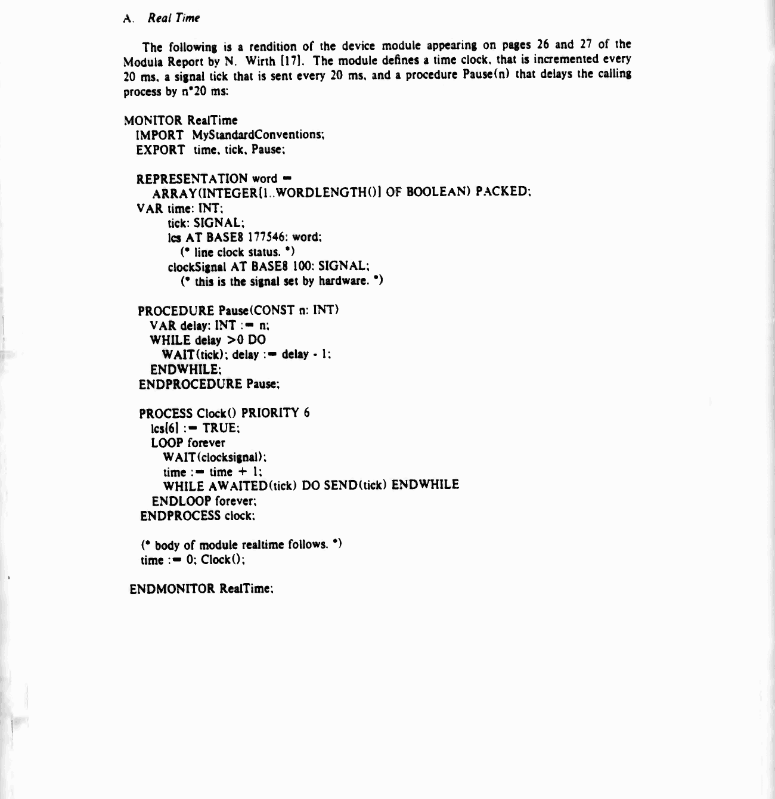
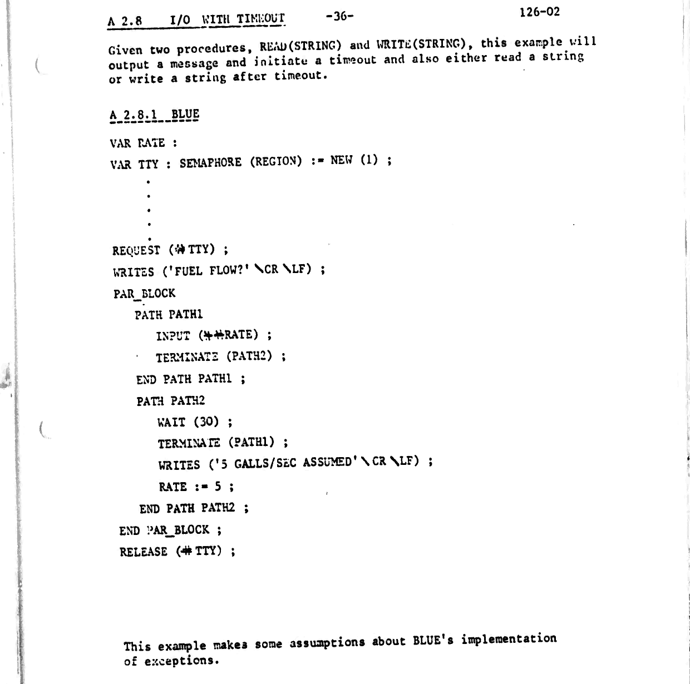
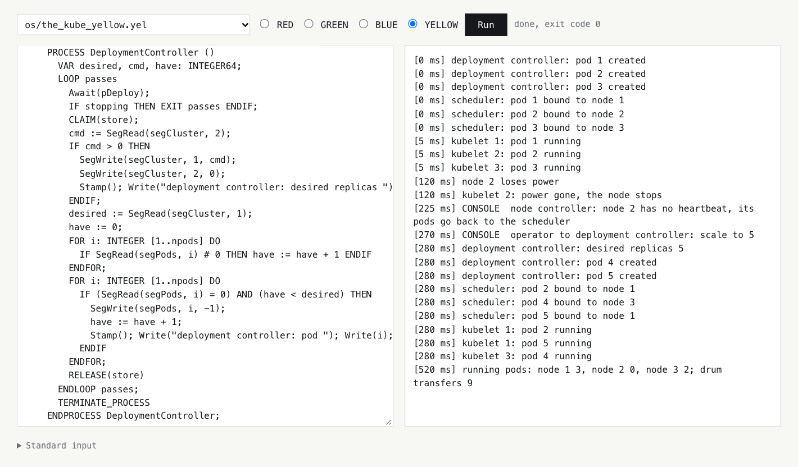
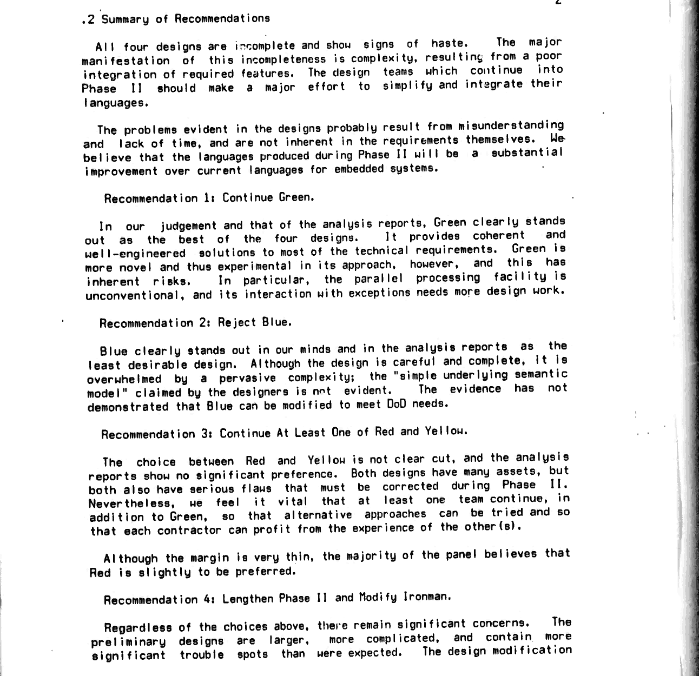
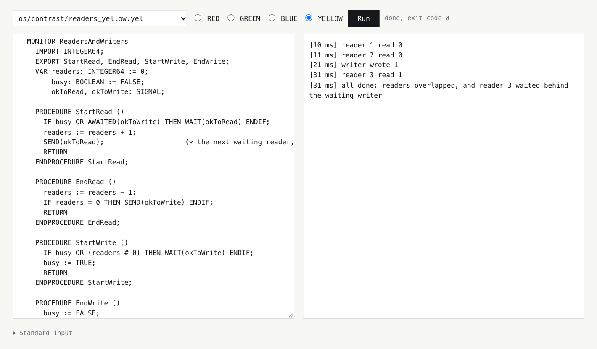

# Two more Adas: I rebuilt the blue and yellow languages the Pentagon rejected in 1978 and wrote Dijkstra's operating system and Kubernetes in them

In February 1978 four teams handed the US Department of Defense preliminary designs for the language that a year later would be named Ada. The designs were anonymized by colour. Green came from Jean Ichbiah's French-American team, Red from Intermetrics of Boston, Blue from SofTech, Yellow from SRI International. In the spring of 1978 Green and Red went through to the second round, while Blue and Yellow went to the archive. A year later Green won and became Ada.

In [the article about the finalists](LINK) I rebuilt the red and green languages: I put them together from the 1979 documents, wrote a self-compiling compiler in each, and grew an operating system and Kubernetes on top of them. Back then Blue and Yellow seemed out of reach. Their documents sat in a volume of four and a half thousand pages that the DoD archive had stopped handing out. Then a copy turned up in a web archive, and I did the same thing with these two languages.

This is the story of the two designs that lost first. Blue is a language in which everything rests on types, even assignment. Yellow is Pascal reworked to meet the military's requirements. Its tasks talk to each other not through the rendezvous, as in the green language and in Ada, where one task waits for another at a "door" and the two meet, but through Hoare's monitors: modules with shared data that only one process can enter at a time. For both languages I wrote compilers in the languages themselves, both ran programs that their authors wrote in 1978 and never saw working, and both now run Dijkstra's THE system with Kubernetes on top of it.

<cut />

But the main thing here isn't the languages themselves. It's that all four designs can now be put side by side and compared not by the reviews but by working code. The same task in the four languages behaves differently, and those differences turned out to be far more interesting than I expected. In the 1978 blue language, a parallel block hands the error of a failed branch to whoever opened the block, something the industry has arrived at only in the last few years. And a lock in it releases itself if its owner has died. Yellow has simulated time built right into the language, where the clock moves only when the program wants it to.

The article is long, so here's a quick map. First, the 1978 book the texts came from, and the people who made these languages. Then a tour of the blue and yellow languages. After that, one and the same task in all four languages and a summary table of the differences, the compilers and the 1978 programs, THE and Kubernetes, and why these designs lost. At the end: what Ada later inherited from them, and what the industry might have become if Blue or Yellow had won the competition.

This is the next part of my series on paleocomputing. I'm interested in the ideas that lived inside technologies that lost: what we lost along with them, and which of the lost things came back later in other technologies. You don't need to read the article about the finalists first: where needed, I'll briefly recall how the red and green languages work.

All the sources, notes and instructions are in the repository [github.com/tym83/paleocomputing](https://github.com/tym83/paleocomputing), under `impl/ada-colors`, available under the Apache 2.0 license.

# A book made for microfiche

First, where the texts came from in the first place. In 2023 a message flashed by on the systemsafety mailing list, where people discuss the reliability of critical software: at the request of one enthusiast, DTIC, the DoD's archive of technical documentation, had scanned the volume "DoD Common High Order Language, Phase 1", number ADB950587, 4575 pages, and it contained all four first-round designs. While I was busy with Red and Green, the DTIC site first went down for maintenance and then started refusing every request, even from an ordinary browser. The Wayback Machine came to the rescue: in September 2023 someone had saved the whole PDF there. It carries the same marking as the RED manual: "approved for public release, distribution unlimited".


The book's preface is a small historical document in its own right. The compilers write that the book was "created for microfiche", cards of photographic film carrying reduced pages that you read through a magnifier, and that "no bound version ever existed", while all two hundred copies of the designs went to the reviewers, so this volume is "the only distributable set of these designs". The colours are revealed there too. And the preface ends with a passage I reread several times: the losing designs "are not to be continued and should be of interest only to researchers", "the goal of the program is convergence", and "it is not appropriate at this time to foster alternatives".

Inside are the four preliminary designs exactly as they were delivered on February 15, 1978. Red is there in its first edition, the very REDL with monitors that the red team later threw out and started over. After the designs come analyses from eighty teams, from universities to defense contractors, and the report of the so-called Pittsburgh panel. That panel studied the analyses, questioned the authors and boiled everything down into the tables used in April 1978 to decide who would go on.

The OCR text is horrible in places: zero instead of the letter O, a dollar sign instead of S, the letter l instead of a percent sign. So every program was checked against the page image, and the blue ones, whose code is full of backslashes and hash signs, were simply retyped from the pictures.

## Who made them

The blue design was led by John Goodenough of SofTech. His is not a minor name in the history of Ada. In 1975 he published one of the first major papers on exception handling in Communications of the ACM, and after the competition it was SofTech, under his leadership, that got the contract for the test suite used to check every Ada compiler for conformance with the standard. Goodenough later headed the group that interpreted the standard, and wrote the requirements for Ada 95. So the blue team lost the language but stayed with Ada for twenty years, just on the other side of the table.

The yellow design was led by Jay Spitzen of SRI International, a research institute in California that was then building SIFT, a fault-tolerant flight computer for aircraft. We'll come back to it. A 1986 Time-Life popular book and Bertrand Meyer both write that the yellow team was advised by Hoare and Wirth. The document itself doesn't name its consultants, but the traces are on every page: the structure of the description follows Wirth's "Pascal Report", the modules are taken from his Modula, the monitors from Hoare's 1974 paper, and the bibliography includes the entries "Hoare, private communication" and "Wirth, private communication".

## What Dijkstra thought of them

Dijkstra spent March 1978 reading all four designs and wrote a review of each. Blue got it for its chapter on types and operations, which, in his words, had grown to 160 (!) pages. Yellow he called a hopeless mess, adding that he sympathized with the consultants who had failed to prevent it. If you remember who are named as the yellow team's consultants, the line stings all the more.

He wasn't enthusiastic about Red and Green either, so by Dijkstra you can't tell the losers from the winners. The difference was decided by the reviewers and the panel, and I'll come back to their conclusions once I've shown both languages at work.

# BLUE: a language in which everything rests on types

Of the four, the blue language looks the most unfamiliar, so I'll start with a short program from a lab. It swaps two integers, two strings and two colours with one and the same procedure:

```
TYPE COLOR = ENUM (\RED, \GREEN, \BLUE);
VAR I, J: INTEGER;
VAR A, B: ASCII_STR (4);
VAR K, M: COLOR;
...
SWAP (# I, J);
SWAP (# A, B);
SWAP (# K, M);

PROCEDURE SWAP (# X, Y: ?T) WHERE T NEEDS (STORE_ (T ## T));
   VAR TMP: T;
   TMP := X;
   X := Y;
   Y := TMP;
END PROCEDURE SWAP;

FUNCTION FRAME (S: ASCII_STR (?L)) RETURNS (ASCII_STR (L + 2));
   RETURN '[' !! S !! ']';
END FUNCTION FRAME;
```

Almost every symbol here means something, so let's go through it in order.


Enumeration literals are written with a backslash: `\RED`, `\GREEN`. This isn't a whim. A literal in the blue language doesn't belong to a single type, and `\GREEN` can be both a traffic-light colour and a rainbow colour at once, at a different position in each. Which one is meant is decided by context, and if the context isn't enough, you state the type explicitly: `[COLOR]$$(\GREEN)`. There are also unordered enumerations, `UNORDERED`, for which only equality is defined: one card suit is never greater or less than another, and the language won't let you pretend otherwise.

A procedure's parameters fall into three groups, input, modifiable and output, and the hash signs go between the groups. In `SWAP (# X, Y)` there are no inputs, and both parameters are modifiable. In `STORE_ (T ## T)` there is one input `T`, no modifiable ones, and one output `T`: assignment takes a value and produces the variable's new value. The groups are visible at the call site too: `SWAP (# I, J)` tells the reader right away that `I` and `J` will change.

`?T` is a generic type inferred from the argument. An instance of the procedure for each type is created by itself, at the call site; nobody names it or declares it. Red worked the same way, while in Green and in Ada the instance has to be created explicitly. It's not only types that can be inferred: `ASCII_STR (?L)` takes the string's length from the argument, and the function `FRAME` promises to return a string of length `L + 2`. The length lives in the type, and the compiler knows it.

And `WHERE T NEEDS (STORE_ (T ## T))` is the list of what the procedure body needs from type `T`. Here it needs only assignment. These operations are taken from the place the procedure was called from, and if the type has no assignment, the call won't compile, with a clear error at the call site rather than somewhere deep inside the instance. Today this is called concepts in C++ or trait bounds in Rust.

## Assignment is a function too

`STORE_` in the previous example is not a typo. In the blue language every operation, including assignment, comparison and taking a substring, is a call to a function with a fixed name: `ADD_`, `EQUAL_`, `LESS_THAN_`, `SUBSTRING_`, `STORE_`. An abstract type exported from a module defines its own addition and assignment in exactly the same way, as ordinary subprograms. Ada still has no user-defined assignment: Ada 95's controlled types let you specify actions after copying and before finalization, but not the assignment itself. In C with Classes, the predecessor of C++, on the other hand, you could already overload assignment in 1980.

One of the 1978 reviewers wrote that "Blue is the closest to using the concept of type and type definition facilities as unifying forces in the language." I don't know a better short description. Fixed-point numbers are specified by scale, radix and precision: `FIXED (scale, radix, precision)`, and `INTEGER` is simply fixed point with a zero scale. For the onboard computers of the seventies, which often had no floating point at all, this was the workhorse, and Blue describes it in more detail than anyone. Strings come in different character sets, and a function over strings is generic over the character set. And at the machine level a type can assign its values the codes chosen by the hardware:

```
TYPE STATUS = UNORDERED (\IDLE, \BUSY, \DONE, \FAULT)
   REP ENUM_VAL_REP (4, VALUES (\IDLE AS BIN '0000', \BUSY AS BIN '0001',
                                \DONE AS BIN '1000', \FAULT AS BIN '1111'));
...
SELECT OBJECT_MACHINE FROM
   PDP_11 -->
      S := [STATUS]$$(REGISTER);
   END;
END SELECT;
```

Two details here. Only an unordered type is allowed to have its own codes: hardware codes can come in any order, and then they couldn't carry the ordering of the values. Ada arrived at the same place from the other side: there any enumeration can be given codes, but they must be ascending. And reading a code from a device register as a value of the type is only possible in the machine-dependent part, inside `SELECT OBJECT_MACHINE`, where the program says plainly which hardware it's doing this on.

## Closed scopes and declared exceptions

As in the red language, a procedure in Blue is a closed scope: it can't see outside variables until it imports them. Blue is stricter than Red here. A procedure that calls another procedure must import either that procedure or all the variables it touches. So the header of any procedure tells you what state it can reach through the whole chain of calls. A hash sign in the import list works the same way as in the parameters: in `IMPORTS (DATA: (# MUTEX, BALANCE))` everything comes after the hash, meaning the variables are imported for modification, and whatever the procedure only reads is written before it.

Exceptions in the blue language are declared in the subprogram header: `SIGNALS (OVERFLOW, INVALID_FORMAT)`. A subprogram cannot let out an exception that isn't on this list. SofTech's justification explains this with exactly the same argument as the import lists: a procedure's interface must be described completely, and what it can throw is as much a part of it as what it can modify. In 1978 practically the only language that did this was Barbara Liskov's CLU, and checked exceptions, the kind the compiler forces you to declare or handle, came into the mainstream with Java. Ada doesn't have them and never did.

An exception handler in the blue language is attached to a statement, not a block: `EXCEPT` can follow any statement. This seems like a trifle until you write `BLOCK ... EXCEPT ... END BLOCK` and discover that the handler belongs to the last statement of the block rather than the whole block. I fell for it, and it's now a separate item in the compiler notes.

## A parallel block that doesn't lose errors

When it comes to concurrency, Blue is the strictest of the four. There are no tasks in the usual sense. There is a parallel block, `PAR_BLOCK`, with paths, `PATH`, inside it, and the block doesn't finish until all its paths have finished. Such a block isn't new in itself; it's Dijkstra's `parbegin ... parend` from 1965. What's new is something else: if some path dies with an exception it is allowed to let out, the block waits for the others and raises that exception itself:

```
VAR MUTEX: SEMAPHORE (REGION) := NEW (1);
VAR BALANCE: INTEGER := 100;
PAR_BLOCK
   PATH WORKER FOR ID IN [1:2] SIGNALS (FAILED) IMPORTS (DATA: (# MUTEX, BALANCE));
      PAUSE (ID);          % PAUSE and LOG are my procedures: a wait in milliseconds
      REQUEST (# MUTEX);   % and a timestamped log line
      PAUSE (5);
      IF ID = 1 THEN
         SIGNAL FAILED;
      END IF;
      BALANCE := BALANCE + 10;
      RELEASE (# MUTEX);
   END PATH WORKER;
END PAR_BLOCK;
EXCEPT
   FAILED --> LOG ('the block signals FAILED: worker 1 ended abnormally'); END;
END EXCEPT;
```

Today this is called structured concurrency: parallel branches live inside a lexical block, the block doesn't finish before they do, and a branch's error isn't lost but reaches whoever opened the block. For the last eight years or so it has been reintroduced everywhere: the Python library Trio, task groups in Swift, `StructuredTaskScope` in Java. Blue is simpler than they are. A failure in one branch doesn't cancel its neighbours; you write that by hand with `TERMINATE`, and if two branches fail, only one exception comes out. But the essential part is already there.

In Ada 83 a block also waits for its tasks, but a task that dies with an unhandled exception just quietly terminates, and whoever started it never finds out. This is one of Ada's best-known traps. The blue language of 1978 doesn't have it.

The strictness has a price too. A parallel block can't be placed inside a subprogram, so you can't start a couple of paths from a procedure, and this will come back to bite us in Kubernetes.

## Two kinds of semaphores

The blue language has no mailboxes and no rendezvous; paths coordinate with each other through semaphores. Dijkstra's semaphore is a counter with two operations: P waits until the counter is greater than zero and decrements it, V increments the counter and wakes one waiter. In the blue language semaphores come in two kinds, and the difference between them is very subtly thought out. A `SYNCH` semaphore is a classic semaphore without an owner: one path waits for an event, another announces it. A `REGION` semaphore is a lock with an owner around shared data, what today we'd call a mutex. If the path holding such a lock terminates abnormally, the lock releases itself.


In the example above the first worker dies with the semaphore in its hands, and the second one gets in right away, so the balance comes out as 110 instead of the second worker waiting forever. The word "abnormally" matters. A path that caught an exception itself and carried on keeps its locks, and that became one of the labs.

Why not release all semaphores when a path dies? SofTech's justification answers like this. Recording "this path holds the lock" can only be done inside the acquire operation itself, because any flag set afterwards might not get set before the path dies. So it's the system, not the path's handler, that has to release a dead path's lock. But if all semaphores were released, the signalling ones would be too, and the dying path would send false signals to those waiting for a completely different event. That's why there are two kinds, and only locks get released.

SofTech itself cites an objection that had been put to it: the data under a released lock may be left half-updated. The justification agrees and replies that in an embedded system the data will soon be "refreshed" with a new set of data from an input sensor. Thirty years later the same problem would show up in the POSIX standard, and it would be solved more strictly: a robust mutex whose owner has died goes to the next one with the code `EOWNERDEAD`, and the new owner must declare the data consistent, or the mutex becomes unusable. Blue has no such signal; the lock is handed over silently.

Time in the blue language isn't quite what you'd expect either. `WAIT (30)` puts a path to sleep for thirty seconds, and those seconds are a binary fixed-point number, so you can't write a millisecond in them exactly. And `CLOCK`, in my reading of the specification, shows the running time of the particular path rather than the time of day.

# YELLOW: Pascal told to satisfy Ironman

If the blue language started from types, the yellow one started from Pascal. The DoD's language requirements were written in stages, and the editions were called Strawman, Woodenman, Tinman, Ironman and Steelman, from a man of straw to a man of steel, each more detailed than the last. The first-round designs were submitted against the 1977 Ironman. SRI writes plainly in its report that its task was to design a language by reworking Pascal to meet the Ironman requirements. The description of the yellow language follows the section numbering of Wirth's "Pascal Report", down to an empty section kept only so that the numbers line up. A program in it reads like Pascal with long closing keywords:

```
MODULE Enumerations
  IMPORT TextIO, StandardImplementationPrelude;
  REPRESENTATION
    Phase = ORDERED (Pending, Running, Succeeded);
    Fruit = UNORDERED (Lemon, Lime, Orange);
  VAR p: Phase := Pending;

  PROCEDURE WritePhase (CONST p: Phase)
    SELECT p
      CASE Pending => Write("Pending")
      CASE Running => Write("Running")
      CASE Succeeded => Write("Succeeded")
    ENDSELECT;
    RETURN
  ENDPROCEDURE WritePhase;

  FOR q: Phase DO WritePhase(q); Write(" ") ENDFOR;
  ...
ENDMODULE Enumerations
```

On top of Pascal come modules from Modula, monitors and signals, module templates, exceptions and overloading. Case matters: reserved words are written in capitals, and names however you like. ASCII had no "not equal" sign, so it's written as a hash, as in Modula.

## Type and representation

SRI's main idea of its own is the separation of type and representation. "Representation" here doesn't mean a machine format, like `REP` in the blue language, but a constraint on values. `INTEGER` is a type, a set of values with operations. `INTEGER [1..10]` is a representation of it, with a range, and for floating-point numbers also with a precision, for fixed-point with a step. A variable can only be declared through a representation; a bare `INTEGER` won't do. On the other hand, two representations of the same type are compatible: `INTEGER [1..5]` and `INTEGER [0..9]` are one type, and assignment between them just checks the range. Enumerations are declared as representations too, in a `REPRESENTATION` section, as in the example above.

This is exactly what Ada calls subtypes: `subtype SMALL is INTEGER range 1 .. 10` doesn't create a new type, it only constrains the old one. Except that in Ada a subtype is an optional extra, while in the yellow language you can't do without a representation. A new type is created by a separate declaration, `TYPE T = INTEGER`, and its literals are written with the type name: `T 50`.

Enumerations are ordered or unordered, as in the blue language, and `BOOLEAN` here is unordered: true is not greater than false. Overloading is explicit only. A new definition of a function with the same name is marked with `EXTENDS` if it is added to the old ones, or `REPLACES` if it replaces them. Without a mark, the new declaration hides all the old ones. So in the yellow language you can't overload something by accident, and when reading you see at once where a name has acquired a new meaning.

## Two rules you trip over on day one

Subtraction in the yellow language is not associative. Addition and multiplication are, and `a + b + c` is written without parentheses, but `a - b - c` is a syntax error, as is `a * b DIV c`. You have to state the order with parentheses: `(a - b) - c`. Pascal and nearly every other language read this expression left to right. This isn't a whim on SRI's part: Ironman required it, item 4G: parentheses are mandatory if a non-associative operator of the same precedence stands to the left. SRI met the requirement literally, while SofTech wrote outright in the Blue justification that this item should be dropped. In the next edition of the requirements it was indeed softened to a wish.

The second rule is more insidious, and it was inherited from Pascal. Comparisons in the yellow language, as in Pascal, bind more weakly than all other operators, more weakly than `AND` and `OR`. So `x > 0 AND b` reads as `x > (0 AND b)` and doesn't compile. And when the types do match, there's no error: `f = f AND g` for Boolean `f` and `g` silently means `f = (f AND g)`. Later I'll show how the language's own authors fell for this rule.

## Pure functions and value-returning procedures

A function in the yellow language is pure: it has only constant parameters, and it can assign only to its own local variables. The same arguments give the same result wherever it is called. That's stricter than Ironman required. For generators like "give me the next number" there are procedures that return a value:

```
FUNCTION Square RETURNS INTEGER64 (CONST x: INTEGER64)
  RETURN x * x
ENDFUNCTION Square;

PROCEDURE NextTicket RETURNS INTEGER64 ()
  ticket := ticket + 1;
  RETURN ticket
ENDPROCEDURE NextTicket;
```

The 1979 green language solved the same problem in almost the same way, and Ada 83 dropped it.

## Templates that rewrite the text

Generics in the yellow language are the simplest of the four. A module template, `TEMPLATE`, is text with parameters, and `INSTANCE` literally rewrites the module afresh, substituting the actual parameters for the formal ones, and only then translates it. Each instance is a new module with its own state, and an error in the template shows up only when an instance brings it out. It's like C++ templates with their three-screen error messages: an error in the body is visible only in the instance. In the blue language, by contrast, the `NEEDS` list is checked at the call site.

## Hoare's monitors

Concurrency, though, is the yellow language's most successful part. Processes communicate only through monitors. A monitor, invented by Hoare and Brinch Hansen, is a module whose procedures execute strictly one at a time, and inside it there are signals: queues in which a process can sleep until the event it needs. In Java and POSIX they're called condition variables. Here's the classic readers-and-writer problem, the monitor from Hoare's 1974 paper, rewritten in the yellow language:

```
MONITOR ReadersAndWriters
  IMPORT INTEGER64;
  EXPORT StartRead, EndRead, StartWrite, EndWrite;
  VAR readers: INTEGER64 := 0;
      busy: BOOLEAN := FALSE;
      okToRead, okToWrite: SIGNAL;

  PROCEDURE StartRead ()
    IF busy OR AWAITED(okToWrite) THEN WAIT(okToRead) ENDIF;
    readers := readers + 1;
    SEND(okToRead);
    RETURN
  ENDPROCEDURE StartRead;

  PROCEDURE EndRead ()
    readers := readers - 1;
    IF readers = 0 THEN SEND(okToWrite) ENDIF;
    RETURN
  ENDPROCEDURE EndRead;
  ...
ENDMONITOR ReadersAndWriters;
```

The yellow language's semantics are Hoare's. `SEND` hands the monitor directly to the process it wakes, and the sender waits until that process leaves the monitor or falls asleep again. So the woken process can check its condition with `IF` rather than `WHILE`: between the signal and the wakeup nobody gets a chance to barge in and spoil everything again. The monitors that made it into the mainstream are different. In 1980, in the Mesa language, Xerox chose semantics in which a signal is only a hint, and the woken process must check the condition again in a loop. That's how `wait` and `notify` work in Java, and POSIX condition variables. Everyone who has written Java knows about the `while` around `wait`; in the yellow language it isn't needed. The price is discipline: a signal is sent only when the condition really holds. As soon as there's a watchdog that wakes a waiter on a timeout while the condition is false, you have to check the condition after waking in the yellow language too.

Waiting has a rank: `WAIT(s, rank)` queues a process by number, and `SEND` wakes the process with the lowest rank. And `AWAITED(s)` asks whether anyone is waiting on a signal. A signal can be bound to an interrupt address, and then the hardware sends it.



There are also binary semaphores, `CLAIM` and `RELEASE`, for those who find a monitor too heavy. But, as we'll see later, they're better left alone.

## Time you can stop

And one last thing that genuinely surprised me in the yellow language. Any `BEGIN ... END` block can be marked with the word `SIMULATED_TIME`. Then everything inside it runs as one sequential program: processes take turns and switch only where someone waits. Inside the block there is its own artificial time. Every statement takes zero units of that time except `DELAY(n)`, which takes exactly `n`, and the clock moves forward only when all the processes inside are blocked.

In other words, simulation with controlled time is built into a 1978 language. The requirement for "a clock for simulation" was in Ironman, and the blue design answered it with a promise to write a simulation module, as in Simula, the Norwegian simulation language that object-oriented programming started from. Yellow turned it into a language construct you can wrap around any piece of a real program. Today people build entire separate systems for the same thing. FoundationDB built all of its testing on deterministic simulation: the program runs on artificial clocks, the network and disks are replaced with models, and any run can be replayed step for step. A whole company grew out of that, selling such an environment for other people's programs. The yellow language doesn't come close to that, of course: the specification doesn't fix the order of processes, and the language doesn't model hardware or failures. But a clock that moves only when the program wants it to is already there. And my whole project rests on the same trick: the runtime of all four languages runs on a virtual clock with a deterministic scheduler, which is why any failure is reproducible down to the millisecond. That's also why `SIMULATED_TIME` changes nothing in my compiler: the program already lives entirely in simulated time.

# Four languages side by side

The 1978 reviewers, as the red team remembered it, split the four designs into two pairs: the conservative Blue and Red, and the ambitious, "academic" Yellow and Green. One from each pair went through to the second round. Now that all four languages work, you can see the split was no accident, and the best way to see it is on one and the same task.

The task goes like this. Two workers take turns updating a shared account under a lock. The first one grabs the lock and crashes in the middle of the update. The question: will the second one get in? It's not an academic question. In any system with locks, from an operating system kernel to a database, the first question you ask about a lock is what happens to it when its owner dies. It will come up again in the chapter on Kubernetes.

In the red language the lock is a `REGION`, and it's released however the body ends:

```
REGION d DO
   DELAY(5);
   IF id = 1 THEN
      RAISE X_RANGE;
   END IF;
   balance := balance + 10;
END REGION;
```

In the 1979 green language, as in Ada 83, the lock is a separate server task with two entries, `SEIZE` and `RELEASE`. All the server knows is that it's waiting for a call to `RELEASE`:

```
task body LOCK is
begin
   loop
      accept SEIZE;
      accept RELEASE;
   end loop;
end LOCK;
...
LOCK.SEIZE;
begin
   delay 0.005 * SECONDS;
   if ID = 1 then
      raise RANGE_ERROR;
   end if;
   BALANCE := BALANCE + 10;
   LOCK.RELEASE;
exception
   when RANGE_ERROR => LOG("worker 1 failed while holding the lock");
end;
```

In Blue the lock is released by the abnormal termination of the path, if it's a `REGION` semaphore: the full code was in the chapter on the blue language. In Yellow there are two answers, and they're opposite. A monitor is freed if a monitor procedure exits by an exception. A binary semaphore, `CLAIM` and `RELEASE`, is never freed:

```
MONITOR Account
  ...
  PROCEDURE Update (CONST id: INTEGER64)
    DELAY(5);
    IF id = 1 THEN PROPAGATE_EXCEPTION OUT_OF_RANGE ENDIF;
    balance := balance + 10;
    RETURN
  ENDPROCEDURE Update;
  ...
ENDMONITOR Account;
```

Here's what these programs print. Red:

```
[1 ms] worker 1 holds the lock
[6 ms] worker 1 failed inside the region
[6 ms] worker 2 holds the lock
[11 ms] both workers are through, balance 110: the region released the lock for the failed one
```

Green:

```
[1 ms] worker 1 holds the lock
[6 ms] worker 1 failed while holding the lock
[100 ms] 1 of 2 workers through, balance 100: worker 2 still waits on SEIZE, nothing released the lock
```

Blue:

```
[1 ms] worker 1 holds the semaphore
[6 ms] worker 1 fails holding it
[6 ms] worker 2 holds the semaphore
[11 ms] the block signals FAILED: worker 1 ended abnormally
[11 ms] both workers are through, balance 110: the path's end released its REGION semaphore
```

Yellow:

```
[1 ms] worker 1 holds the monitor
[6 ms] worker 1 failed inside the monitor
[6 ms] worker 2 holds the monitor
[11 ms] both workers are through, balance 110: leaving the monitor by an exception gave it up
[11 ms] worker 3 claimed the semaphore
[16 ms] worker 3 failed between CLAIM and RELEASE
[112 ms] worker 4 asked 100 times: no exception gives a semaphore back
```

To be fair: the green worker could call `RELEASE` in its own handler, and the yellow one could do the same for the semaphore. But that's manual discipline, and it's easy to forget. More importantly, it doesn't help when the worker isn't brought down by an exception but killed from outside: in the green language and in Ada an aborted task runs no handlers, and the lock is lost for real. The difference is who is responsible for releasing it, the programmer or the language.

Three languages out of four take it on themselves, each in its own way. Red ties the release to the program text: you've left the `REGION`, the lock is free. Blue ties it to the life of the path: the path has died, its locks are free, but its signals aren't. Yellow ties it to the module boundary: an exception has carried you out of the monitor, the monitor is free. Only in Green, that is, the winner, does the language itself not release the lock, because it has no separate mechanism for shared data. A lock there is a task like any other, and it knows nothing about the death of a client. Ada got such a mechanism only in 1995: the protected object, essentially a monitor whose entries have barriers instead of signals, conditions under which an entry is open.

And one more detail, visible only in the blue program: the block learned about the death of the first worker and reported it. In the other languages the worker caught the error itself, and had it not, the task would simply have terminated quietly and nobody would ever have known.

## Readers and writer

The second task is readers and writer. Three readers arrive at 0, 1 and 3 milliseconds, the writer at 2. Reading and writing take ten milliseconds each. A good solution lets readers read at the same time and doesn't let a reader who arrived after the writer overtake it, or else, with a steady stream of readers, the writer will never get its turn.

| Solution in the repository | Read concurrently | A late reader overtakes a waiting writer | Everything done by |
|---|---|---|---|
| RED, exclusive `REGION` | no | no, everyone stands in one queue | 40 ms |
| GREEN, the server hands out copies of the data | yes, on copies | the third reader gets a stale copy | 13 ms |
| BLUE, P and V semaphores | yes | yes | 23 ms |
| YELLOW, Hoare's monitor | yes | no | 31 ms |

This isn't the limit of the languages but the solutions I chose: with semaphores there is also a writer-priority variant, described by Courtois, Heymans and Parnas back in 1971, it's just noticeably longer. Hoare's monitor gives it in twenty lines, because that's the kind of problem it was invented for. The price is visible too: the third reader dutifully waits for the writer and finishes at 31 milliseconds rather than 23.

## Waiting with a timeout

The third task is to wait for a reply, but no longer than a given time. This is where the differences turned out to hurt the most.

In the red language it's a single construct, `WAIT`, which waits for the first of several events, a timer included. In the 1979 green language only a server can wait with a timeout, through a `select` with a `delay` alternative. A client can't limit its own wait; that kind of call appeared only in Ada. And in the blue and yellow languages no process can wait for two events at once, say, an item in a queue or the expiry of a timer, whichever comes first. Blue solves this with a race between two paths, Yellow with a watchdog that wakes the waiter, or by polling a semaphore with `CONDITIONAL_CLAIM`. More on this in the chapter on Kubernetes, because there are plenty of timeouts there, and the cost of these solutions became visible straight away.

## Summary table

Below is how the four designs differ from each other and from Ada 83. Red and Green here are in their 1979 edition, Blue and Yellow in their 1978 one.

| | RED | GREEN | BLUE | YELLOW | Ada 83 |
|---|---|---|---|---|---|
| Basis | Pascal, rewritten from scratch | Pascal | Pascal, rewritten around types | Pascal and Modula | GREEN after four years of revisions |
| Modules | capsules | packages | modules and segments | Modula modules | packages |
| Outside variables in a procedure | imported only | visible | imported only, along the whole call chain | visible inside the module | visible |
| Generics | instances created automatically | explicit instances | instances created automatically, type requirements in `NEEDS` | module templates rewrite the text | explicit instances |
| Operations | overloading | overloading | everything, assignment included, is a function with a fixed name | explicit overloading only, via `EXTENDS` and `REPLACES` | overloading, no user-defined assignment |
| Functions | no side effects unless marked | no side effects, plus value-returning procedures | input parameters only | no side effects, plus value-returning procedures | input parameters only, side effects allowed |
| Exceptions | declared as names | declared as names, 15 predefined | listed in the subprogram header | not declared | declared as names, 5 predefined |
| Concurrency | tasks and mailboxes | tasks and rendezvous | paths in a parallel block | processes and monitors | tasks and rendezvous |
| Lock for shared data | `REGION` | server task | `REGION` semaphore | monitor | server task |
| Waiting with a timeout | `WAIT` with a timer | server only | race of two paths | watchdog or polling | both server and client |
| Task didn't catch an exception | terminates quietly | terminates quietly | the block raises the exception | terminates quietly | terminates quietly |
| My compiler in the language itself | about 5000 lines | about 7000 lines | about 9600 lines | about 6000 lines | — |

Read the table row by row and the pairs show up at once. Blue and Red both require variables to be imported, both create generic instances by themselves, both provide a separate lock for data. Yellow and Green both lean towards side-effect-free functions and a single elegant concurrency mechanism, except that Yellow chose the monitor and Green the rendezvous. And the row about the unhandled exception shows that of the five languages only Blue doesn't lose a task's error.

# Two compilers and programs nobody had ever compiled

The goal was the same as for the finalists: each language should have a compiler written in itself. A compiler is an honest test of a language. If you can write a few thousand lines of parsing, symbol tables and type checking in it, the language is real; if you can't, it shows immediately.

The path was the same too. First, a small translator in Python that understands a subset of the language. The first version of the compiler is written in that subset, and the Python translator builds it. Then the compiler builds itself, and the result is compared with the previous one: if the second generation matches the third byte for byte, a fixed point has been reached. The compiler, built by itself, produces exactly itself and no longer depends on the Python translator. From then on the repository keeps a "seed", the C code of the compiler generated by the compiler itself, from which it can be built without Python. After that the language grows inside the compiler, and each new version is built by the previous one. Both compilers translate a program into C and build it with the same shared runtime as the red and green languages, with a virtual clock and a deterministic scheduler.

Both compilers reached the fixed point on the first attempt. The Blue compiler grew to about nine and a half thousand lines, almost twice the size of Red's, even though some things from the specification, such as record packing and alias checking, I never did implement in it. I think this is the best measure of the blue language's complexity: everything in it that hinges on types, the compiler has to honestly infer and check. The Yellow compiler is about six thousand lines. The yellow language has no strings as values, not even concatenation, and all the text in its compiler lives in one big pool of characters, where every string is a number. That's roughly how Pascal compilers lived in those same seventies.

## The 1978 programs

With the programs from the documents, the story turned out more interesting than with the finalists. There was no implementation at all in the first round, for anyone. So nobody had ever translated a single program from the blue and yellow designs, and my compilers were the first for these texts.

The blue document has seventeen programs. If you fill in what the original replaces with an ellipsis, eight of them translate and work as printed. Two more translate but work incorrectly. In the matrix product, for example, because of a single letter the first term of every element is taken from the first matrix instead of the second. The remaining seven don't get past the compiler because of errors like `BUFF` instead of `BUF` or arguments in the wrong order.

The biggest program is Appendix C, the standard input/output library, thirteen hundred-odd lines, with teletype drivers bound to PDP-11 interrupts. To translate it I had to rename the procedure `IN`, even though that's a reserved word, and remove a constant exported by two modules, even though by the rules a module exports only types and subprograms. Together with the typos that came to about two dozen fixes, seven of them violations of the language's rules, and after that the library worked on a simulated PDP-11 with two LT33 teletypes (that's what DEC called the Teletype Model 33). For thirteen hundred lines that nobody had ever compiled, this is a very good result, and it says more about the blue team than any review.

The yellow tutorial has fifteen programs, and four of them compile as printed. The rest have the kinds of errors any text accumulates when nobody has run it through a translator: `ConvexHullFinder` is closed as `ComplexHullFinder`, and the sorting example writes `IMPORTS` and `EXPORTS` from some other language. But more often the authors forgot the rules of their own language, above all that very rule about comparisons. In the scheduler for SIFT, the condition `ept > 0 AND enabled[pri]` reads as `ept > (0 AND enabled[pri])` and means something quite different from what was intended.

Three programs still work incorrectly after the fixes. In the exchange sort, string comparison considers one string greater than another only if each of its letters is greater than the corresponding one, so it never reorders ordinary names; and the convex hull construction for eight points whose hull has five marks only two. At first, of course, I decided the translator was at fault, and the same algorithm was rewritten in Python. It marked the same two points. The bug was in the 1978 algorithm, and for forty-eight years nobody noticed it, because there was nothing to run the program on.

All the fixes are in the repository as separate files, and the sources are kept exactly as printed, along with an explanation of each fix and the rule that was broken.

# THE and Kubernetes without messages

A compiler tests a language on sequential code. To test concurrency, in the article about the finalists I wrote several systems in the red and green languages, and now I repeated them in Blue and Yellow.

The first is THE, the multiprogramming system that Dijkstra's group built in Eindhoven in 1965–1968. It's a society of sequential processes arranged in layers: at the bottom, semaphores and processor allocation; above them the memory controller, which shuttles segments between memory and the magnetic drum, the slow backing store of those years; higher still the single operator console, the input/output buffers and the user programs. A process only calls on the layers below it.

The second is Kubernetes on top of THE: the Kubernetes controllers run as level-four user programs, the object store lives in segments on the drum, and every node has a kubelet that runs pods. The third is the Kubernetes control plane on its own, without THE, to test exactly what real Kubernetes rests on. It has an API server that itself pushes every object change to its subscribers (in Kubernetes this is called a watch), controllers with their own copies of the state, and leases: records a node must renew regularly to be considered alive.

And straight away it became clear what unites the blue and yellow languages and how they differ from the finalists. Neither has messages, and neither can wait for two events at once, say, an item in a queue or the expiry of a timer, whichever comes first.

## Blue: THE feels at home

THE in the blue language turned out to be almost a native. Blue's semaphores are exactly Dijkstra's P and V, and the program prints exactly the same thing as the red-language version, character for character. Each layer of the system is a module, so each process's import list says outright which layers it calls on. To print timestamps in the shared log, all the system's processes had to be made paths of a single parallel block started at time zero: the blue language's clock shows the path's time, not the time of day.

And then came the thing that made rebuilding the whole blue language worth it. Kubernetes on THE has a power-off scenario: a node loses power, its kubelet dies, and the control plane has to notice the node is gone and move the pods. The store in THE is guarded by a semaphore, like everything in this system. In the red language this is a P-and-V semaphore in Dijkstra's spirit, not a `REGION`: a `REGION` is tied to a block of text, whereas in THE one process does P and another V, and acquire and release often live in different places. So a kubelet that died in the middle of writing to the store took the semaphore with it, and the whole control plane froze. Dijkstra wrote that his group's first major mistake was spending too long designing the system for an ideal installation and thinking about failures too late. A process that dies inside a critical section is a special case of that mistake, and I repeated it in five minutes. In the red and green languages I had to move the power-off into the gap between the kubelet's passes, where it holds nothing.

In the blue language the store's semaphore is declared as `REGION`, and it's still an ordinary P-and-V semaphore, just with an owner. You can acquire it in one procedure and release it in another, and if the path dies, the system releases it by itself. Now the node can lose power in the middle of a kubelet pass, even during a write: the kill reaches the path at its nearest wait point, the path's death releases the semaphore, and the control plane lives on. For this to work, the kubelet, having caught the notice that it's being killed, raises it again; otherwise the path would end normally and keep the lock. The data under the lock may be left half-written, and SofTech's justification answered that it would soon be refreshed with fresh sensor readings. In Kubernetes the same role is played by the controller's next pass, which once again compares the desired with the actual. What the red language got from a lexical block, Blue gives for an ordinary semaphore with an owner, that is, for exactly what THE is built on.

## Blue: a timeout as a race

Timeouts are harder. Acquiring a semaphore has none, and the blue language has no way to say "wait for an item, but no longer than thirty milliseconds". The answer turned up in the same book, from the reviewers. One of the teams solved an input-with-timeout problem in all four languages, and here is its blue version, retyped from the picture:



```
REQUEST (# TTY);
WRITES ('FUEL FLOW?' \CR \LF);
PAR_BLOCK
   PATH PATH1
      INPUT (## RATE);
      TERMINATE (PATH2);
   END PATH PATH1;
   PATH PATH2
      WAIT (30);
      TERMINATE (PATH1);
      WRITES ('5 GALLS/SEC ASSUMED' \CR \LF);
      RATE := 5;
   END PATH PATH2;
END PAR_BLOCK;
RELEASE (# TTY);
```

Two paths race, and whichever gets there first kills the other. If the operator hasn't answered within thirty seconds, the fuel flow is taken to be five gallons per second. I like that this example holds the whole era: a military console, a teletype and a sensible default. And the weakness of the idiom is already visible here: if the timer fires between the input and `TERMINATE (PATH2)`, the value entered gets overwritten with a five.

In the standalone Kubernetes in Blue, every wait works this way, and the cost of the idiom shows immediately. A parallel block can't be placed inside a subprogram, so the wait loop can't be hidden in a procedure, and it had to be written twice: for the family of controllers and for the kubelets. The race is safe only if the waiting path has a higher priority than the timer. Otherwise the timer can kill it at the moment when the semaphore has already handed it an item but the path hasn't yet picked it up: the item stays in the queue, but there's nobody left to take it. That became one of the labs. Priority saves the day here only because there's one processor and the priorities are strict. The right way is for cancellation to return what was handed out, or for the "take and mark" section to be non-interruptible, as in Ada, where an abort is deferred until the end of a rendezvous and of protected operations. And a killed path can't tell who exactly killed it, its own race or the user who switched off the node. The kubelet of the blue Kubernetes learns about the power-off from a note the user leaves for it before killing it.

## Yellow: everything on monitors

The yellow language builds everything on monitors. Its semaphores are binary only, so Dijkstra's counting semaphores became monitors with a counter and two signals, the very bounded buffer from Hoare's monitors paper. The memory controller became a monitor too, and it turned out simpler than Dijkstra's: a process that needs a segment does the work itself inside the monitor, and the queue to enter the monitor is the request queue.



Kubernetes on top of THE in the yellow language prints the same as in the red one, byte for byte. Its store, as in the red version, is guarded by a semaphore, a binary one, to keep THE's P and V, and a binary semaphore isn't released when a process dies. So here too the power goes off between the kubelet's passes. A monitor would have released itself: an exception that carries a process out of a monitor frees it, like the red language's `REGION`.

What the language lacks shows in the workarounds, and for timeouts I tried several. In the small comparison program, the timeout is a watchdog that wakes the waiter without slipping it anything: the woken process sees the condition is still false and decides by itself to stop waiting. In Kubernetes on THE, a clock process wakes all the controllers every ten milliseconds. And in the standalone Kubernetes I took a simpler route and set up one clock process that every twenty milliseconds puts an empty tick event into each quiet event stream, essentially the same fake item the watchdog slips in in the semaphore-based THE.

There can't be an array of monitors, because a monitor is a module, not a value. So the standalone Kubernetes's eight event streams, one per subscriber, are eight named instances of a single template, and the right one is picked by a select statement on its number. Starting a process returns neither a name nor a number, and to cut the power to the second node, the kubelet itself writes its identifier where the user will find it. A program with running processes can't finish until they finish, and the eternal controllers have to be asked to stop with a flag and one last signal.

## What came of it

Both systems work and print the same as their red and green twins, in places byte for byte. The blue language turned out to be the most convenient for THE and the least convenient for Kubernetes, where timeouts are at every step. Yellow is the opposite: monitors fit Kubernetes very naturally, but everything to do with time and with process names had to be built by hand. And the common conclusion for both is this: a language with a single synchronization mechanism copes, but pays for every missing mechanism with a separate process. The green language in the article about the finalists paid the same way, with a buffer task instead of a mailbox.

# Why they lost

The Pittsburgh panel that pulled the analyses together consisted of David Fisher, David Gries, Brian Kernighan, John Reynolds, Philip Wetherall and William Wulf. Its report is dated April 4, 1978. The panel opens by saying that "all four designs are incomplete and show signs of haste", and its conclusion turned out simple. The reviewers considered Green the best and Blue the worst, and saw almost no difference between Red and Yellow. If you read the analyses themselves, though, the picture is far more varied. Some teams put Yellow first, others last. One wrote that Yellow was the worst-designed of all and shouldn't be continued; another considered it a reliable choice for the systems programmer and, apparently, the cheapest to implement. And yet another ended its analysis with my favourite piece of advice: the best thing the DoD could do would be to ask the red team to implement the yellow language. Well, the yellow language has now been implemented.



On Blue the panel was the most brief: "Reject Blue." The design "is careful and complete", but "it is overwhelmed by a pervasive complexity; the 'simple underlying semantic model' claimed by the designers is not evident". One team admitted that Blue had suffered from its own presentation and that this had surely affected its assessment, and in its summary table Blue and Yellow got the worst score for how easily a typo changes the meaning of a program. The rebuild confirmed both halves of the verdict. The care is real: the input/output library with its drivers started working after a dozen typos were fixed, and the two kinds of semaphores turned out more precise than anything the finalists had. But the complexity is real too: Blue's translator came out the biggest of the four, almost twice the size of Red's, and the backslashes, hash signs and double exclamation marks read worse than in any of its neighbours.

Yellow lost by a hair. The panel wrote that "the choice between Red and Yellow is not clear cut", and "although the margin is very thin, the majority of the panel believes that Red is slightly to be preferred". But in the section on Yellow itself the words are harsh: type and representation are confused, "there is no workable mechanism for process identification", "monitors have not been used for significant systems", and on the whole "the attempt to build on Pascal and its cousin Modula has not been successful". Here my experience agrees with the panel by half. On process identification it's right exactly where I stumbled myself. But monitors turned out to be the most convenient part of the yellow language for THE and Kubernetes, and by 1978 Brinch Hansen had already, two years earlier, described the Solo operating system, written with Concurrent Pascal monitors. The irony is also that the red design, which beat Yellow by a hair, was soon thrown out by the red team itself, which wrote the language anew in the second round.

Put the four languages side by side and you see four answers to one question: how many synchronization mechanisms does a language need. Green chose the rendezvous, Blue semaphores, Yellow monitors, and only Red offered several mechanisms at once. Three designs out of four bet on a single main mechanism, and in none of those three can a caller simply say "I'll wait no longer than so many milliseconds": in Green only the server has a timeout, in Blue you're left with a race of paths, in Yellow with a watchdog or polling. And in the chapter on Ada we'll see that Ada eventually took the monitor back too, under the name of the protected object. The book's compilers wrote that the losing designs "should be of interest only to researchers". It seems they were right, except that the researchers showed up forty-eight years later.

# What Ada inherited from them

Ada 83 is the green language after four years of revisions, and it has no direct inheritance from Blue and Yellow. But if you lay the 1978 designs next to the whole history of Ada up to Ada 2022, you get the same picture as with the red language: much of what the losers offered from the start, Ada picked up over decades, in its own words and, as a rule, without knowing it was repeating someone from 1978. Let me go over the main points.

## What matched from the start

Subtypes. The yellow language's representations are Ada's subtypes: `INTEGER [1..10]` and `subtype SMALL is INTEGER range 1 .. 10` mean the same thing. Subtypes came to Ada from the green language, so this is a resemblance, not a borrowing, and the only difference is that in Ada you can do without a subtype.

Machine-level representations. The blue language assigned hardware codes to enumerations through `REP`; Ada does the same in chapter 13 of the standard. Blue allowed custom codes only for unordered types; Ada allows them for any, but requires the codes to be ascending. Both teams saw the same problem, the order of values versus the order of codes, and solved it from different sides.

Parentheses where the reader might go wrong. Ironman required parentheses around non-associative operators, Yellow did this literally, Blue refused, and in Steelman the requirement was softened to a wish. Not much of it survived in Ada, but some did: you can't mix `and` and `or` without parentheses, and `a ** b ** c` is an error too.

## What came later

Monitors. Ada 95 introduced protected objects, and the Ada 95 rationale names monitors outright among their ancestors. A protected object is a monitor that has barriers instead of signals, and callers waiting on an open entry are served before new calls. In other words, Ada 95 kept Hoare's main guarantee, the one the yellow language gave through `SEND`: between the moment a condition becomes true and the moment the waiter wakes up, nobody can barge in. Leaving a protected operation by an exception frees the object, just like leaving a yellow monitor. Ada came back to the monitor seventeen years after rejecting the yellow language.

Explicit overloading. The yellow language's `EXTENDS` and `REPLACES` required you to mark whether a new definition adds a meaning to a name or replaces the old one. An idea similar in spirit came to Ada 2005 as the `overriding` and `not overriding` indicators, though for methods rather than for any name: so that a typo in a name doesn't turn an override into a new method. C++11 got `override`, Java the `@Override` annotation. The industry arrived at this through bugs that the yellow language ruled out by syntax.

Side-effect-free functions and import lists. The yellow language required a function to touch nothing but its own local variables, and the blue one required the header to list every outside variable the procedure reads or changes, along with the access mode. Ada 83 had neither. It came back through SPARK, a strict subset of Ada for provable code, and in Ada 2022 became part of the language: the `Global` aspect lists a subprogram's outside objects together with their access mode. That's almost word for word the blue language's `IMPORTS` list from the workers example.

Concurrency that doesn't lose errors: it arrived, but in the wrong place. Ada 2005 introduced task termination handlers: you can find out that a task died with an unhandled exception, but the exception doesn't propagate to whoever started the task. Ada 2022 introduced parallel blocks, `parallel do ... and ... end do`: the block waits for all its branches, a failure in one cancels the others, and the exception comes out. This is structured concurrency in the modern sense, even stricter than Blue's block. But it's for computation, while Ada's tasks with their rendezvous still lose errors exactly as they did in 1983.

## What never came

A lock that is released when its owner dies. A protected object is freed if an operation exits by an exception, but a task inside a protected operation can't be aborted: Ada defers the abort until the operation ends. So Ada solved the same problem as the blue language, just from the opposite side: Blue releases the dead owner's lock, Ada won't let you die while you hold the lock.

Declared exceptions. The `SIGNALS` list in the header of a blue subprogram didn't make it into Ada. Java got checked exceptions, and the industry is still arguing about whether that's a good thing: C# and Kotlin deliberately left them out. So here the blue language bet on an idea that hasn't won conclusively anywhere.

User-defined assignment, like Blue's `STORE_`, never appeared in Ada.

Generics without explicit instances. In Ada a generic instance is still created explicitly, and the required operations are passed as formal subprograms. The closest thing to Blue's `NEEDS` is `with function "<" (L, R : T) return BOOLEAN is <>`, which picks up the matching operation at the point where the instance is created. In essence it's the same list of requirements on a type, except you still have to create the instance by hand.

Ada has no simulated time and never did.

## Three teams out of four

John Goodenough, the head of the blue design, spent twenty years after the competition making sure Ada compilers conformed to the standard, and the standard to itself. Ada 95, as I told in the article about the finalists, was designed by the Intermetrics team, the authors of the red language. So of the four 1978 teams, three ended up responsible for Ada in one way or another. Only the yellow one was left out.

# If Blue or Yellow had won

In the article about the finalists I tried to imagine a world where the red language won in May 1979. In short: Ada would have separated messages and shared data from day one, generic instances would have been created without declarations, and PL/SQL in every Oracle database would have been written in a language with mailboxes. Here the fork comes earlier, in April 1978, when Green and Red were taken into the second round. Let's imagine the panel had decided otherwise.

First, what wouldn't have changed in any of the worlds. The DoD's Ada mandate held from 1987 to 1997 and ended not because of rendezvous or monitors but because the commercial market went to C and C++, and the requirement cost more than it gave. Those economics didn't depend on the colour of the language. So any winner would have become the language of avionics, railways and space, and almost certainly not the language of everything else. The differences below are differences inside that niche, and in which ideas leaked from it into the mainstream.

## A world where Blue won

The first thing that would have happened is delay. Ada compilers were late as it was: the first one to pass the conformance check appeared only in 1983. The blue language is the heaviest of the four to implement. Inferring generic instances from arguments, checking imports along the whole call chain, computing fixed-point scales: all of this costs years of work. The pressure towards language subsets, which the DoD prohibited, would have been stronger.

The second is a culture of strict specification. Even in our world Goodenough built the test suite for Ada compilers. In the blue world the same strictness would have been visible in the language itself: every procedure in every DoD project would declare what it touches and what it can throw, and the compiler would check it mechanically.

The third is generic programming. Alexander Stepanov, having started with Scheme, built a library of generic algorithms for Ada with David Musser in the late eighties, and only then moved to C++, where he missed constraints on template parameters. He pushed for concepts for many years, until they made it into C++20. The blue language had type constraints from the very beginning, in `WHERE T NEEDS`, and instances were created by themselves. In the blue world, generic algorithms with type constraints could have appeared in a military language in the mid-eighties.

The fourth is concurrency. A parallel block that doesn't lose its branches' errors would have become the norm for onboard software forty years before Trio and Swift. And locks that are released when their owner dies would have entered the textbooks along with the language. The blue world has no messages, but in ours too military software lived on shared memory and Ada tasks, not on messages. Message-based languages, from Erlang to Go, would have reached them by their own path, so here the blue world is neither worse nor better than ours.

And the fifth, quite down to earth. PL/SQL in Oracle is largely built on Ada because Ada was the DoD's language. In the blue world, procedures in every Oracle database would begin with `PROCEDURE P (# X, Y: ?T)`, and enumeration values would be written with a backslash. I'm not sure database administrators would have survived it.

## A world where Yellow won

The yellow world is arranged quite differently, because Yellow is Pascal. In 1979 Pascal was already taught everywhere, Wirth was finishing Modula-2, and a few years later Turbo Pascal would make Pascal the language of personal computers. Of the four, the yellow compiler is the simplest after the red one, and it would have been built on the ready base of Pascal compilers, so a yellow Ada would most likely have come out earlier than ours. Add to that the DoD's seal: the language of textbooks, the language of PCs and the language of military systems would have turned out to be one family. The school of Wirth and Hoare, which in our world lost to C, would have gained an industrial ally with an enormous budget. Would it have beaten C? Hardly; C had Unix. But the eighties would have passed as a contest between two equal families rather than as the slow displacement of Pascal.

Hoare's monitors would have become standard in 1980, together with his semantics, in which the woken process gets the monitor handed over directly. In our world monitors reached the mainstream through Mesa and Java, with the mandatory loop around `wait`. Mesa chose its semantics for practical reasons, and Java might well have chosen the same in the yellow world too. But a generation of programmers trained on military monitors would have known both variants and the price of each. And Ada 95 wouldn't have needed protected objects: the language would already have had the monitor. Instead, yellow Ada would have had to add what it lacked for me: a timeout on waiting, process names and arrays of monitors. The panel wrote plainly in 1978 that Yellow had no way to identify a process, and in the second round this would, of course, have been fixed.

The yellow world would have had its own traps too. Comparisons that bind more weakly than `AND`, the very ones the authors themselves tripped over in the SIFT scheduler, would have lived in aircraft code until they were fixed in the second round or analysers started catching them.

The most interesting difference of the yellow world is `SIMULATED_TIME`. Any piece of an onboard system could have been wrapped in a block with artificial time and run reproducibly. That wouldn't have solved every problem: you'd still have had to enumerate different process orderings yourself, as today's deterministic simulation systems do, and the language doesn't model hardware failures. But timing bugs could have been reproduced on the bench from 1980 on, instead of being chased for years at the customer's site. In our world we got there in the 2010s.

And there would have been a different Hoare lecture. In 1980 he received the Turing Award, and in his lecture "The Emperor's Old Clothes" he told how he had been giving advice to the Ada project since 1975, and warned that the language was too complex to be trusted with people's lives. In the yellow world Ada would have grown out of a language that, by all accounts, he himself had advised on.

## Four worlds

Put all four variants together and you get this.

| Winner | What military software would have become | What would have reached the mainstream sooner |
|---|---|---|
| GREEN, our world | rendezvous, explicit generic instances, later protected objects | exceptions and generics that influenced C++ |
| RED | mailboxes, `REGION` locks, custom schedulers | the separation of messages and shared data, generic instances without declarations |
| BLUE | strict types, two kinds of semaphores, the parallel block | structured concurrency, constraints on generic parameters, locks with owners |
| YELLOW | Pascal with monitors and simulated time | simulation with controlled time, Hoare's monitors, side-effect-free functions |

The strangest thing about this table is that every row except the first describes something the industry arrived at anyway, only later and piecemeal. Almost none of the losers' ideas disappeared. They came back under other names: protected objects, concepts, structured concurrency, deterministic simulation. The 1978 competition wasn't choosing between good and bad ideas, but between which of them we would get in the eighties and which in the twenties.

# Labs, and how to get your hands on all this

As in the earlier parts, I wanted readers to be able not just to read about the language but to break something with their own hands. The twelve exercises in the red language are now joined by fifteen new ones, seven in Blue and eight in Yellow. They're about what only these languages have, and the `check.sh` script translates your version of a program, runs it and tells you whether you've completed the task. Time in the programs is virtual and the scheduler is deterministic, so you can compare your output with someone else's character for character.

In the blue language:

- the literal `\GREEN`, which belongs to two enumerations at once and sits at a different position in each;
- a single `SWAP` procedure for integers, strings and colours, whose instances nobody declared;
- the import list: remove one procedure from it and find out that Blue requires you to import either it or everything it touches;
- device status codes as values of an unordered type, read from a register;
- a `REGION` semaphore released by the death of a path, and then the same thing with a signalling semaphore that isn't released, and a hung second worker;
- the THE system, in which the bottom layer starts reporting to the operator, that is, calling a layer above itself, and the whole system freezes; you could have spotted this in advance, because the call was in the import list from the start;
- a timeout as a race of two paths: take the priority away from the waiter and lose an item in the queue.


In the yellow language:

- `a - b - c` without parentheses, and the translator's refusal;
- `CONST`, `VAR` and `OUT` parameters, and an output parameter that doesn't change if the procedure ended with an exception;
- ordered and unordered enumerations;
- a module template for a stack, and an instance of the template for a type without ordering, on which the template breaks only in the instance;
- a monitor with wait ranks, where the woken process gets the monitor handed over directly: remove `SEND` and see that a signal isn't a state, and without it nobody wakes the waiters;
- a pure function that won't be allowed to change a global variable;
- a module that exports a variable read-only, and a type whose insides aren't visible from outside;
- the THE system on monitors, which can be broken by the same call from a lower layer to an upper one.



To run all of this, you only need a C compiler and make:

```sh
git clone https://github.com/tym83/paleocomputing
cd paleocomputing/impl/ada-colors
make                         # builds redc, needed for THE and Kubernetes in Red
make -C blue fixpoint        # builds bluec from the seed and checks the fixed point
make -C yellow fixpoint      # the same for yellowc
os/run.sh                    # THE and every Kubernetes variant in all four languages
labs/check.sh b5 look        # the REGION semaphore lab
labs/check.sh y1 break       # check your change in the minus-sign lab
```

If you have Cozystack at hand, you don't need to install anything. The application catalog I put together for this series has an environment for languages, and all four languages arrived there as a single image: you specify the `ada-colors-run` image, put in a source file, and the program runs as a one-off job whose output becomes its log. When the image is built, all four compilers go the whole way from their seeds again and check that they reproduce themselves.

The easiest way, though, is to open [the page in your browser](https://tym83.github.io/paleocomputing/red/). Everything happens right there on the page, with no server. All four translators, built to WebAssembly from the same C seeds, translate the source to C; then clang, also built to WebAssembly, compiles that C, and the program runs with a thread for every task. The runtime is the same file as on Linux, with the same virtual clock, so the programs print in the browser exactly what they print on an ordinary machine, byte for byte. CI checks it: it runs every example in headless Chrome and compares the output. The first run downloads the C compiler, about twenty megabytes, and after that the browser keeps it.


# What I'm taking with me

At the end of each part of the series I ask myself what's worth carrying over from what I found into today's infrastructure.

First, a lock should know that its owner has died. In 1978 the blue language split semaphores into two kinds for exactly this reason, and SofTech's justification explains in two paragraphs what in distributed systems we learn from outages: it's the system, not the dead owner's handler, that should release the lock, and only the lock, not the signal. But the difference from today is instructive. On a single machine the system sees that a path has died. Over a network death isn't visible, only silence is, so in Kubernetes locks are leases: a node or a leader regularly renews a record, and if it stops, its lock is considered free. The former owner may meanwhile be alive and unaware that the lock now belongs to someone else, and the defence against that is a separate generation number, checked by everyone who accepts a write. The blue language solved the problem for a world where death is visible. We got a harder problem, but the first step is the same.

Second, concurrent work should have an owner. If a controller starts a goroutine that nobody waits for and whose errors nobody reads, that's exactly what the blue parallel block protected against in 1978.

Third, first make time controllable, then go looking for bugs. This whole series rests on a virtual clock, and the yellow language, as it turned out, offered the same thing right in its syntax.

Fourth, every missing mechanism is paid for with a separate process. Blue, without timeouts, paid with a race of paths; Yellow with a watchdog process; Green, without mailboxes, with a buffer task. When a platform lacks a primitive, somebody builds it anyway, only everyone in their own way and with bugs. That's a good argument for not skimping on primitives.

And fifth: studying the losers is useful so that you know in advance which ideas will come back, and don't pay for them a second time.

What's next. All four of the competition's designs now work, but something else is left from the first round: REDL, the first edition of the red language, with monitors and events, which the red team threw out. And the reviewers' reports on the 1979 final, which decided between Red and Green, still exist only on microfiche. If you have access to them, let me know.

The sources, tests, labs and all the notes are in the repository [github.com/tym83/paleocomputing](https://github.com/tym83/paleocomputing), under `impl/ada-colors`. If you find a mistake in my reading of the 1978 specifications, let me know; I'm genuinely curious.
