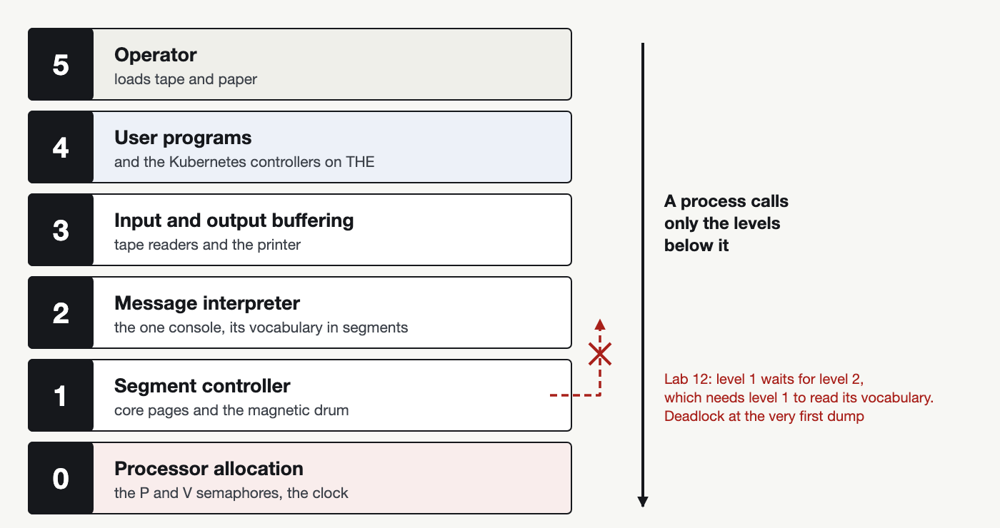

# Dijkstra's THE

Tandem isn't the only system of those years that asked to be written in RED. Ten years before Guardian, in 1965–1968, Dijkstra's group in Eindhoven built the THE multiprogramming system, and the paper about it became one of the most cited in the history of operating systems. Its central idea is hierarchy. The system is a society of sequential processes laid out on levels 0 to 5: processor allocation and semaphores on level 0, the segment controller that moves information between core and the magnetic drum, the slow backing store of those years, on level 1, the message interpreter that owns the only console on level 2, buffering of input and output on level 3, user programs on level 4 and the operator on level 5. Dijkstra's semaphore is a counter with two operations: P waits until the counter is greater than zero and decrements it, V increments the counter and wakes one waiter. A process calls only on levels below it, and Dijkstra claimed that this is what lets the system's correctness be proved in advance and its testing be exhaustive.



I [built THE in RED](https://github.com/tym83/paleocomputing/blob/main/impl/ada-colors/os/the.red), about four hundred lines. The semaphores turned out to be mailboxes of tokens: P takes a token, V puts one back. `REGION` won't do here, because in THE one process does the V and another does the P, while RED's critical section only brackets code inside one process. Eight segments live in three core pages, and the controller dumps the surplus to the free drum page with the least latency, exactly as the paper says. Three paper tape readers fill buffers, three programs compute sums of squares, the printer asks the operator for paper on its third line, and a hundred and forty milliseconds later the operator loads it.

The most interesting thing in the paper is one passage that's easy to miss. Dijkstra explains why the message interpreter sits above the segment controller rather than beside it: the console's vocabulary is stored in segments, so to print a sentence the interpreter needs the controller. I checked what happens if the order is broken. In [lab 12](https://github.com/tym83/paleocomputing/blob/main/impl/ada-colors/labs/red/12-the.red) the segment controller reports every dump to the operator, so a level-1 process waits for a level-2 one. The system freezes at the very first dump:

```
[20 ms] CONSOLE  reader 1: tape loaded, reading
[30 ms]   segment controller: segment 1 dumped from core page 1 to drum page 6
[40 ms] CONSOLE  reader 2: tape loaded, reading
*** deadlock: every task is waiting (t=400)
```

The controller waits for the console, and the console waits for the controller to read its vocabulary. One arrow pointing up, and Dijkstra's proof no longer holds.


For comparison I wrote [THE's core in GREEN](https://github.com/tym83/paleocomputing/blob/main/impl/ada-colors/os/the_green.grn) too. It has neither semaphores nor mailboxes, so each semaphore becomes a server task that accepts P only while its count is positive. It works, but nine lines printed by three programs through a shared buffer cost 54 rendezvous, six for every printed line. Where RED simply takes a token from a mailbox, GREEN calls a server task and waits for a rendezvous with it on every P and V.

Now that THE runs, Kubernetes can run on it too. But first, how Kubernetes works on mailboxes.
